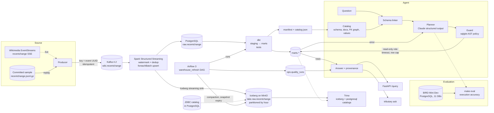

# Tributary: plan

A self-hostable streaming data platform with an analytics agent whose answers
are measured, not claimed. `docker compose up` brings up Kafka, a Spark
Structured Streaming ingest job, a PostgreSQL warehouse modelled with dbt,
an Apache Iceberg copy of the raw events on S3-compatible object storage
queried through Trino, Airflow orchestration with data-quality checks, and a
FastAPI serving layer.
On top sits a text-to-SQL agent that answers questions about the warehouse,
is graded on a public benchmark (BIRD Mini-Dev, PostgreSQL dialect, execution
accuracy) and is guarded against unsafe queries at the SQL-AST and database
level.

## Goal

**Problem.** Teams that collect event data want two things that rarely ship
together: a pipeline they can trust (no lost or duplicated events, checked
freshness and quality) and a way for non-SQL users to ask questions of the
result. Text-to-SQL products exist, but most sit on top of an unknown
warehouse, report accuracy from a slide deck, and treat "the model wrote
`DELETE`" as somebody else's problem. Vanna, the best known open-source
option, was archived in early 2026; Wren AI remains, built around a hosted
semantic layer. Nothing small, self-hostable and *measured* fills the gap
between "a Kafka tutorial" and "an enterprise BI product".

**Users.**
- Small engineering or analytics teams who already have an event stream and a
  Postgres box, and want a reference pipeline plus a question-answering API
  they can audit.
- Data engineers who want a complete, runnable example of the modern batch +
  streaming stack (Kafka, Spark, dbt, Airflow) with tests, not slides.
- Anyone building a text-to-SQL agent who wants a harness that grades it on
  BIRD Mini-Dev in PostgreSQL, with corrected labels, for a few dollars.

**The demo data is real.** The default source is the public Wikimedia
EventStreams feed of edits to every Wikipedia (`recentchange`): a genuine,
bursty, multi-language event stream with bots, reverts and late events. A
captured sample ships in the repo so everything is reproducible offline;
`--live` switches the producer to the real stream.

**What makes it impressive.**
1. **The hard part, named: trustworthy answers.** The agent's headline number
   is execution accuracy on BIRD Mini-Dev (500 questions, 11 databases,
   PostgreSQL dialect), reported on both the official labels and the
   corrected labels from the VLDB 2026 annotation-error study, with per-cost
   and per-latency figures, ablations (schema linking, execution-feedback
   repair, voting) and a 100%-or-fail safety suite. Every number comes from
   `make eval` and is recorded with its cost in RESULTS.md.
2. **A pipeline whose correctness is tested under failure.** `make bench`
   produces events with known ids, kills the Spark job and the broker
   mid-stream, restarts them, and asserts zero loss and zero duplicates in the
   warehouse, while measuring end-to-end latency and throughput. The
   throughput run is repeated at 1, 3 and 6 partitions and names the stage
   that caps each one. The same events land in an Iceberg table, and the
   same queries are timed on PostgreSQL and on Trino over Iceberg, with the
   effect of hour partitioning measured rather than assumed.
3. **Answers carry provenance.** Each answer says which marts it read, when
   they were last refreshed, and whether their quality checks passed. Stale or
   failing tables are flagged in the answer, not hidden.
4. **It ships.** One Compose file, one pip package with a CLI
   (`tributary ask "..."`), typed code, CI, structured logs, read-only
   database roles, no secrets in the repo.

## Architecture

### Components

| Component | Directory | Technology | Role |
|---|---|---|---|
| Producer | `tributary/ingest/producer.py` | `confluent-kafka` (idempotent producer) | Replays the committed sample at a configurable rate, or reads the live Wikimedia SSE stream (User-Agent set, canary events dropped, resume with `Last-Event-ID`). Keys messages by the event's UUID. |
| Broker | `compose.yaml` | Apache Kafka 4.2 (KRaft, single node) | Topic `wiki.recentchange`, 3 partitions by default (`TRIBUTARY_TOPIC_PARTITIONS`). |
| Stream job | `tributary/stream/job.py` | PySpark 4.1 Structured Streaming (`local[N]`, N matched to the topic's partitions) | One Spark application, two streaming queries over the same Kafka source, each with its own checkpoint. **Warehouse query:** explicit JSON schema, event-time watermark, `dropDuplicatesWithinWatermark` on the event UUID, `foreachBatch` sink into `raw.recentchange` with `COPY` + `ON CONFLICT DO NOTHING`. **Lake query:** the same parse and dedup, written with Iceberg's native streaming sink to `lake.raw.recentchange`. |
| Object store | `compose.yaml`, `docker/minio/` | MinIO (built from its last tagged release, see Risks) | Bucket `lake` holding the Iceberg data and metadata files. S3 endpoint, keys and path-style access come from env, so any S3-compatible store can replace it. |
| Lakehouse table | `tributary/stream/lake.py` | Apache Iceberg 1.11 (`iceberg-spark-runtime-4.1_2.13`), Parquet, JDBC catalog in PostgreSQL | `lake.raw.recentchange`, format v2, partitioned by `hours(event_ts)`. The catalog is a schema in the existing PostgreSQL, so no extra service is needed for metadata. |
| Query engine | `docker/trino/` | Trino 484 (single node) | Catalogs `iceberg` (same JDBC catalog, S3 file IO on MinIO) and `postgresql` (the warehouse, read-only role). Used for the query-engine comparison and for federated queries that join lake events with warehouse marts. The agent does not use it. |
| Warehouse | `warehouse/` | PostgreSQL 17, dbt-core 1.12, dbt-postgres | Schemas `raw` → `staging` → `marts` (`fct_edits`, `dim_wiki`, `dim_page`, `agg_edits_hourly`, `agg_editor_activity`). dbt tests plus custom freshness and volume-anomaly tests. `manifest.json` + `catalog.json` are the agent's source of truth for table and column descriptions. |
| Orchestration | `orchestration/dags/` | Apache Airflow 3.3 (LocalExecutor) | `warehouse_refresh` (dbt run → dbt test → quality checks → publish catalog) on an asset schedule; `lake_maintenance` (Trino's Iceberg `optimize` on closed hours, `expire_snapshots`, `remove_orphan_files`) hourly when the `lakehouse` profile is up; `ops.quality_runs` records every check, including a Postgres-vs-Iceberg row-count reconciliation per closed hour. |
| Serving | `tributary/api/` | FastAPI, structlog, psycopg 3 | `/health`, `/catalog`, `/freshness`, `/sql` (guarded raw SQL), `/query` (question → SQL → rows → answer with provenance). API-key auth, request ids, per-key rate limit, Prometheus `/metrics`. |
| Agent | `tributary/agent/` | Anthropic SDK (`claude-opus-5-5` default), Ollama fallback, Fake provider for tests | `catalog.py` (schema + descriptions + FK graph + value index), `linker.py` (schema linking), `guard.py` (AST policy), `planner.py` (structured-output SQL draft + repair loop), `answer.py` (rows → answer + provenance). |
| CLI | `tributary/cli.py` | Typer | `tributary ask`, `sql`, `catalog`, `eval`, `bench`, `produce`. |
| Evaluation | `eval/` | pytest-style harness, sqlglot | BIRD Mini-Dev loader, execution-accuracy scorer, corrected-label track, schema-linking scorer, guard suite, cost ledger. |
| Benchmarks | `bench/` | Compose + Python driver | Fault-injection ingest benchmark and latency/throughput measurement. |

### Data flow



### The agent's query path

1. `Catalog.load()` reads dbt's `manifest.json` and `catalog.json` (or, for a
   plain database such as a BIRD schema, `information_schema` plus the
   benchmark's column-description CSVs) into tables, columns, types,
   descriptions, foreign keys and a small index of distinct values for
   low-cardinality text columns.
2. `link_schema(question, catalog, k)` returns the subset of tables and
   columns the planner should see. Baselines: `full` (everything) and `bm25`
   (lexical). The `core` strategy adds value matching and join-path
   expansion so the subset is connected.
3. `Planner.draft()` calls the model with a cached system prefix (dialect
   rules, the linked schema rendered as DDL with descriptions, a few
   examples) and the question, using structured output
   (`SQLDraft{sql, tables, assumptions, confidence}`), adaptive thinking and
   the fallback setting enabled.
4. `Guard.check(sql)` parses with sqlglot (PostgreSQL dialect) and rejects
   anything that is not a single `SELECT`/CTE, references schemas outside the
   allowlist, calls a blocked function (`pg_sleep`, `dblink`, `lo_*`, ...),
   or exceeds an `EXPLAIN` cost ceiling; it then injects `LIMIT` if missing.
5. Execution runs as the `tributary_reader` role with
   `default_transaction_read_only = on`, a statement timeout and a row cap.
   A database error is fed back to the planner for at most two repairs.
6. `answer.compose()` turns rows into a short answer and attaches the SQL,
   the tables read, each table's last refresh and its latest quality status.

### Key design decisions

| Decision | Chosen | Alternatives considered | Why |
|---|---|---|---|
| Warehouse engine | PostgreSQL 17 | DuckDB (fast analytics, single file); ClickHouse (columnar) | BIRD Mini-Dev ships PostgreSQL gold queries, so the benchmark and the product share one dialect and one guard. Postgres also hosts Airflow's metadata and supports concurrent writers. The cost is slower large scans; the demo scale (millions of rows) is fine, and the plan records this as a known limit. |
| Streaming engine | Spark Structured Streaming in local mode | A plain Python consumer; Kafka Streams; Flink | Spark is a target skill and gives watermarks, stateful dedup and checkpoint recovery for free. Local mode in one container keeps Compose light; the job is written against the same API a cluster would use. A Python consumer would be simpler but would re-implement exactly these semantics by hand. |
| Exactly-once | Idempotent sink keyed by the event UUID, plus Kafka idempotent producer and Spark checkpoints | Kafka transactions end to end | Transactions do not reach PostgreSQL; an idempotent `ON CONFLICT DO NOTHING` sink gives effectively-once delivery that survives any crash point, and the fault-injection benchmark proves it instead of asserting it. |
| Lakehouse layer | Raw events also written as an Iceberg table (Parquet) on object storage | Delta Lake; Hudi; Parquet files without a table format | Iceberg has hidden partitioning (`hours(event_ts)` without a derived column, so queries filtering on the timestamp prune), snapshot isolation, and first-class support in both Spark and Trino. Plain Parquet would leave commits, schema evolution and pruning metadata to hand-written code. Delta's Trino support is good too, but Iceberg is the engine-neutral choice. |
| Writing two sinks | Two streaming queries in one Spark application, separate checkpoints; Iceberg's native streaming sink for the lake | One `foreachBatch` that writes both | Iceberg's streaming sink records the query id and batch id in each snapshot and skips a batch it has already committed, so a replayed micro-batch does not duplicate rows. A dual write inside one `foreachBatch` would need `MERGE INTO` on the event id to stay idempotent (a full-table join per batch) and would couple the two sinks' failures. The cost is reading Kafka twice; the bench measures it. |
| Iceberg catalog | JDBC catalog stored in the existing PostgreSQL | Iceberg REST catalog (Polaris, Lakekeeper); Hive Metastore; Nessie | Spark and Trino both support the JDBC catalog, and it adds no service: commits are row updates under PostgreSQL's transactions. A REST catalog is the production direction (credential vending, multi-engine governance) and is noted in the roadmap. |
| Query engine | Trino over Iceberg and PostgreSQL | Spark SQL (Thrift server); DuckDB with the Iceberg extension | Trino is what data platform teams run for interactive SQL over a lake, and its connectors make the Postgres-vs-lake comparison and federated joins possible from one SQL endpoint. DuckDB would be faster on one box but has no PostgreSQL-catalog federation story at the same level, and Spark SQL's start-up latency is a poor fit for interactive queries. |
| Agent's engine | PostgreSQL only; Trino is not exposed to the agent | Let the agent choose an engine | One dialect keeps the guard, the benchmark and the product aligned. A Trino dialect for the guard is a stretch goal (see Milestones). |
| Transform layer | dbt-core 1.12 with dbt-postgres | Spark SQL batch jobs; hand-written SQL in Airflow tasks | dbt gives tests, docs and lineage as data; the agent reads the manifest and catalog directly, so column descriptions written once serve both humans and the model. dbt Fusion (2.0) is still pre-release and was not chosen. |
| Orchestrator | Airflow 3.3 with assets and the Task SDK | Dagster; Prefect; cron | Airflow is the posting keyword and 3.x assets map cleanly onto "refresh when raw data changed". |
| Data quality | dbt tests plus two custom tests (freshness, volume z-score), results persisted to `ops.quality_runs` | Great Expectations; Soda Core | Both frameworks add a second DSL and a service; the checks needed here are a few SQL statements, and persisting results to a table is what makes provenance possible. |
| Agent model | `claude-opus-5-5` default, pluggable provider (`anthropic`, `ollama`, `fake`) | A fine-tuned open text-to-SQL model | A general model plus good grounding is the realistic production choice; Ollama (`qwen2.5-coder`) keeps the offline path alive and gives a second column in the results table. |
| Safety | Defence in depth: AST policy, read-only role, statement timeout, row cap, schema allowlist | Prompt instructions only; regex deny-list | Regexes miss comments, CTEs and function calls; the AST policy is testable against an adversarial suite and the database role catches whatever the parser misses. |
| Benchmark | BIRD Mini-Dev (PostgreSQL), official and corrected labels | Spider 1.0 (SQLite, saturated); Spider 2.0 (BigQuery/Snowflake accounts) | Mini-Dev is the only major benchmark with PostgreSQL gold, is small enough to run for dollars, and has a published corrected label set, so the label-noise problem (52.8% error rate reported) can be measured rather than ignored. |
| Schema linking | A pluggable strategy with measured baselines | Always send the full schema | Full schema is the baseline and often wins on small databases; linking is what scales to real warehouses, and the eval shows exactly when it helps or hurts. |
| Demo source | Wikimedia `recentchange`, committed sample by default | Synthetic e-commerce generator | Real data has the warts (bots, bursts, Unicode, late events) that make the pipeline worth testing. The sample keeps `comment` text out (CC BY-SA) and keeps factual fields only. |

### Repository layout

```
tributary/            package: ingest/, stream/, agent/, api/, cli.py, config.py, logging.py
warehouse/            dbt project (models, tests, macros, seeds)
orchestration/dags/   Airflow DAGs
eval/                 benchmark loaders, scorers, recorded fixtures, results
bench/                ingest fault-injection, scaling and query-engine benchmarks
data/sample/          captured recentchange sample (gzip JSONL)
docker/               Dockerfiles (app, spark, airflow, minio) and Trino catalog config
docs/                 architecture notes, screenshots, demo GIF
tests/                unit and integration tests
compose.yaml, Makefile, pyproject.toml, RESULTS.md, RELEASE.md
```

## Evaluation

### Datasets

| Dataset | Size | Dialect | Licence | Use |
|---|---|---|---|---|
| BIRD Mini-Dev, official (`birdsql/bird_mini_dev`, the 2025-07-04 release's `mini_dev_pg` file; databases from `minidev.zip`: SQLite files, description CSVs and the `BIRD_dev.sql` PostgreSQL dump) | 500 questions, 11 databases; 148 simple, 250 moderate, 102 challenging | PostgreSQL | CC BY-SA 4.0 | Headline execution accuracy. `make bird` downloads and loads the databases (never committed); the two question files and the derived catalogs are committed (under 1 MB) so the replayed eval and `make eval-link` run offline. If the PostgreSQL dump is unavailable, the loader converts the SQLite databases and verifies every gold query executes. |
| BIRD Mini-Dev, corrected (`uiuc-kang-lab/text_to_sql_benchmarks`, `arcwise_plat_sql_only_with_diff.json`) | 498 questions, same databases; 449 kept after verification | SQLite gold, transpiled to PostgreSQL with sqlglot and verified by running on both engines | CC BY-SA 4.0 | Second track. Items whose transpiled gold fails on either engine or returns different rows are dropped and counted by reason. |
| Guard suite (`eval/guard/`) | 112 unsafe statements (DML, DDL, `pg_sleep`, `COPY`, `dblink`, stacked statements, comment tricks, `information_schema` probes, field notation) + the warehouse's 40 gold queries and BIRD's 500 official and 449 corrected gold queries as the benign sets | PostgreSQL | repo | Safety: block rate and false-block rate. |
| Ingest benchmark | 50,000 sample events with known ids | n/a | derived from Wikimedia data (factual fields only) | Exactly-once and latency under fault injection. |
| Query benchmark (`bench/queries/`) | 10 analytical queries over the raw events, run on the sample scaled to 1M and 20M rows: copy *i* of the 50,000 events is shifted by *i* times the sample's time span and gets ids `uuid5(i, original id)`, so the distributions are real and the volume is synthetic (the sample spans 36 min 19 s of event time, so 1M rows are about 12 event hours and 20M about 10 event days) | PostgreSQL and Trino | derived from Wikimedia data (factual fields only), generated on demand, never committed | Postgres vs Trino-over-Iceberg latency and the partition-pruning effect. |
| Warehouse question set (`eval/warehouse_questions.yaml`) | 40 questions about the demo marts with hand-checked SQL | PostgreSQL | repo | Sanity check that the product works on its own data; also the demo script. |

### Metrics and how each number is measured

| Number | Metric | Command | Method |
|---|---|---|---|
| Execution accuracy (EX) | Fraction of questions whose predicted SQL returns the same set of rows as the gold SQL, values compared as the database driver returned them (BIRD's `calculate_ex`: order and duplicates ignored, column order and value types count), with a Wilson 95% interval; a type-blind "lenient" count beside it | `make eval` | Both queries run on the same database as a read-only role with a 30 s timeout. Every live pair is also graded by the official `calculate_ex`, compiled from the pinned upstream `evaluation_ex.py`, and disagreements are reported; `make bird` does the same on the 449 corrected-vs-official gold pairs. Reported per difficulty, per track (official, corrected) and per variant. |
| Ablations | EX for `full`, `bm25`, `core` linking × {no repair, repair} × {single, vote-of-3} | `make eval VARIANT=...` | Same harness; each variant's cost and p50/p95 latency are logged from `usage` in the API response. |
| Model comparison | EX for `claude-haiku-5-5` (all variants), `claude-opus-5-5` (best variant, 200-question stratified subset), Ollama `qwen2.5-coder:7b` (best variant, hardware permitting) | `make eval MODEL=...` | Same harness. |
| Schema-linking quality | Table recall@k, share of questions with every gold table linked, and precision against gold tables (parsed from gold SQL with sqlglot) | `make eval-link` | Offline, no model calls, committed catalogs; runs in CI. |
| Guard | Block rate on the unsafe suite (must be 100%); false-block rate on 500 gold queries (target 0%) | `make eval-guard` | Offline; runs in CI. |
| Exactly-once | Events produced vs distinct rows in `raw.recentchange` after killing and restarting the Spark job and the broker mid-stream (3 crash points, 3 repetitions) | `make bench` | Compose on a 4-vCPU machine; duplicates and losses must be 0. |
| Latency and throughput | End-to-end p50/p95 from produce time to warehouse insert time; sustained events/s at steady state | `make bench` | Same run, timestamps stamped by the producer and the sink. |
| Throughput scaling | Sustained events/s and end-to-end p95 at 1, 3 and 6 topic partitions, with Spark matched (`local[P]`, one task per Kafka partition, `spark.sql.shuffle.partitions = P`, P sink connections) | `make bench-scale` | For each P the topic is recreated and the job restarted from an empty checkpoint. An open-loop producer offers a stepped rate (each step 90 s); the sustained rate is the highest step at which consumer lag (latest offsets minus the offsets in Spark's `StreamingQueryProgress`) stops growing over the step's last 60 s. p95 latency is measured in a separate 3-minute run at 80% of that rate. Three repetitions, median reported, `nproc` and Compose CPU and memory limits recorded. |
| Bottleneck attribution | Which stage caps throughput at each P: broker, Spark micro-batch, or the PostgreSQL sink | `make bench-scale` | Each stage's ceiling is measured on its own at the same P: the broker with Kafka's `kafka-consumer-perf-test`; Spark with the `noop` sink (Kafka read, parse, dedup, no write); the sink by replaying the recorded batch sizes as `COPY` + `ON CONFLICT` from P connections. The full pipeline's rate is compared with the three ceilings, and the attribution is checked against `StreamingQueryProgress.durationMs` (time in `addBatch`, with the sink's own timer inside `foreachBatch`, vs `latestOffset`, `queryPlanning`, `walCommit`), per-container CPU from `docker stats` and PostgreSQL wait events from `pg_stat_activity` sampled each second. One extra row at P = 3 runs with the Iceberg query enabled to show what the second sink costs. |
| Query-engine latency | Median and p95 wall-clock per query and engine, at 1M and 20M rows | `make bench-query SCALE=...` | Both stores are loaded from the same generated DataFrame in one Spark batch job (the ingest path is measured separately), then the Iceberg table is compacted. Engines: PostgreSQL directly (primary key plus a BRIN index on `event_ts`, its counterpart to pruning), Trino over the `postgresql` catalog, and Trino over Iceberg. The queries are written once in SQL both dialects accept, with a dialect variant only where a function differs (percentiles). Every engine's result must match PostgreSQL's (row multiset, float tolerance 1e-9) before its timing counts. One discarded warm-up, 10 measured runs, plus one run per query after stopping the engine's containers, dropping the host's page cache (`sudo -n`, where allowed; recorded either way) and starting them again, reported separately as "cold". Each engine runs alone with the stream job stopped and no CPU limit, so the one being timed has all the cores; PostgreSQL gets 4 GB and Trino 3 GB plus MinIO 1 GB (`bench/compose.query.yaml`), and the settings are recorded. |
| Partition pruning | For the hour-window queries: latency, data files read and physical bytes read on the table partitioned by `hours(event_ts)` vs an unpartitioned copy of the same rows (Trino CTAS), and vs the uncompacted streaming layout | `make bench-query` | Files and bytes come from Trino's query statistics (`EXPLAIN ANALYZE` and the client's `stats`); PostgreSQL's blocks read from `EXPLAIN (ANALYZE, BUFFERS)` are reported beside them. |
| Freshness and quality | Share of `warehouse_refresh` runs with all checks passing over the bench run; freshness lag p95 | `make bench` | Read from `ops.quality_runs`. |
| Cost | Dollars per question per variant, from token usage and the published price list | `make eval` | Written next to each EX figure in RESULTS.md. |

### Baselines and reference points

- The zero-shot `full` schema variant with no repair is the baseline every
  other variant must beat or explain.
- Published Mini-Dev leaderboard figures are SQLite results from 2024-era
  models and are cited as context, not as a comparison row.
- Label noise is handled by reporting both tracks; the delta between them is
  itself a result.

### Cost plan

Haiku 5.5 at $0.10/$0.50 per million tokens with a cached schema prefix:
about $0.40 per 500-question variant, roughly $3 for the full ablation grid.
One Opus 5.5 pass on the 200-question subset: about $7. Total under $12.
The ingest, scaling and query-engine benchmarks make no model calls. If
no key is available the harness runs on real local-model recordings
through Ollama (the model named in RESULTS.md), RESULTS.md lists the Claude
commands and their cost under "To measure", and a definition of done that
names Claude recordings is met by the local model's; no milestone waits on
a key.

## Release

**How users get it.**
- `pip install tributary` gives the CLI and the agent; `tributary ask` works
  against any PostgreSQL URL plus a dbt manifest, and against a running
  Tributary API.
- `git clone` + `docker compose up` brings up the platform with the sample
  data flowing within two minutes, including MinIO and the Iceberg sink;
  profile `lakehouse` adds Trino (about 2 GB of heap, so it is opt-in),
  profile `airflow` adds the scheduler and web UI, profile `bird` loads the
  benchmark databases.
- A GitHub Container Registry image for the API and the Spark job, built on
  tags.

**What the maintainer must provide.**
- `ANTHROPIC_API_KEY` as a repository secret: enables the `integration` and
  `eval-live` CI jobs (both skipped without it).
- PyPI trusted publishing for the `tributary` project (or a `PYPI_API_TOKEN`
  secret) before the first tag; the release workflow is guarded by
  `if: startsWith(github.ref, 'refs/tags/v')` and does nothing otherwise.
- GHCR needs no secret beyond the default `GITHUB_TOKEN` with `packages:
  write`.
- No hosted demo: the platform needs a broker and a JVM, so the README demo
  is a GIF of `docker compose up` followed by `tributary ask`.

RELEASE.md will carry the exact steps.

## Risks

| Risk | Mitigation |
|---|---|
| CI cannot run Kafka + Spark + Postgres + Airflow quickly | Unit tests mock everything; one integration job uses Compose with the `platform` profile only (no Airflow) and a 5,000-event replay; Airflow DAGs are tested with `dag.test()` against Postgres only. |
| BIRD PostgreSQL dump is distributed through a Google Drive package that may be rate-limited | Loader prefers the Hugging Face files; fallback converts the SQLite databases to PostgreSQL and verifies each gold query executes; the loader caches under `~/.cache/tributary`. |
| Label noise makes EX hard to interpret | Two tracks (official, corrected) reported side by side; item-level diffs kept in `eval/results/`. |
| sqlglot cannot parse some valid PostgreSQL | The guard fails closed (unparseable = blocked) and the false-block rate on 500 gold queries measures the cost of that choice. |
| Spark local mode on a 4-vCPU box starves Postgres | Trigger interval and `maxOffsetsPerTrigger` are configurable; the bench records the settings used. |
| At P = 6 on a 4-vCPU machine Spark has more tasks than cores, so the scaling curve may flatten for reasons that have nothing to do with Kafka | That is reported as the finding it is: `nproc` and per-container CPU are recorded, and the attribution says "CPU-bound in Spark" when the `noop` ceiling stops rising with P. If a larger machine is available, the run is repeated there and both are reported. |
| MinIO's upstream repository was archived in April 2026 and `minio/minio` is no longer on Docker Hub (checked 2026-10-16; last release `RELEASE.2025-10-15T17-29-55Z`) | `docker/minio/Dockerfile` builds that tagged release from source in a multi-stage build, so the image is reproducible and pinned. The store is reached only through S3 settings (endpoint, keys, path-style), and the M2 integration test runs against whichever store is configured, so swapping to SeaweedFS (Apache 2.0, active) is a config change. The swap is made if the source build fails or a security issue appears. |
| Iceberg streaming writes produce many small files (one or more per partition per micro-batch) | `lake_maintenance` compacts closed hours with `optimize` and expires snapshots; the query comparison reports file counts and latency before and after compaction. Snapshot retention stays well above any restart window (Trino's default is 7 days): the streaming sink finds its last committed batch by walking the current snapshot's ancestors, so expiring a recent ancestor would let a replayed micro-batch commit twice. The fault-injection bench runs with maintenance enabled to check this. |
| Trino plus Spark plus Kafka plus Postgres exceed a laptop's memory | Trino is in the `lakehouse` profile with a fixed heap; Compose sets memory limits per service, and RESULTS.md records them with every benchmark. |
| PyPI `pyspark` version drifts from the `apache/spark` image | The Spark job container is built from the `apache/spark:4.1.x-python3` image and pins the matching `pyspark`; the rest of the package never imports pyspark. |
| Wikimedia stream terms (small-scale tools only) | Live mode is opt-in, sets a descriptive User-Agent, reconnects with backoff, and is never used in CI. |
| Model cost or key unavailable | Fake provider with recorded responses for CI; live evals sized to under $12 total; cost printed per run. |
| Provider API drift | Single `provider.py` boundary; integration test pinned to the SDK version in `pyproject.toml`. |

## Milestones

- [x] M1: Scaffold, CI and the ingest spine — `uv` project with ruff, mypy strict, pytest and a GitHub Actions workflow; `compose.yaml` with PostgreSQL 17 and Kafka 4.2 (KRaft); the committed 50,000-event sample; the producer with replay and `--live`; the Spark Structured Streaming job writing `raw.recentchange` with watermark, dedup and the idempotent sink; `tributary produce` and `tributary stream` commands; structured logging and env config. Done when `docker compose up` shows rows landing in `raw.recentchange`, an integration test replays 5,000 events through Kafka and Spark into Postgres in CI and asserts the count, and unit tests pass offline.
  - *Changes made while building M1.* Event time is the MediaWiki `timestamp`, not `meta.dt`: the sample shows `meta.dt` is the emit time and trails the change by up to 144 s, so it is kept as `emitted_at`. The producer and the stream job share one image (`docker/spark/Dockerfile`); the slim app image arrives with the API in M3. The integration workflow runs on changes to the ingest path and by hand, not on every push. The 10-minute watermark is justified by the sample's measured lateness (RESULTS.md).
- [x] M2: Warehouse, lakehouse and orchestration — dbt project (`staging`, `marts`, seeds, generic and custom tests for freshness and volume anomaly), `warehouse_refresh` Airflow 3 DAG with assets, `ops.quality_runs`, catalog export (`manifest.json` + `catalog.json` + value index) to a known path, Compose profile `airflow`. The lakehouse: MinIO image built from source, the Iceberg JDBC catalog in PostgreSQL, the second streaming query writing `lake.raw.recentchange` (partitioned by `hours(event_ts)`), Trino in profile `lakehouse` with `iceberg` and `postgresql` catalogs, the `lake_maintenance` DAG and the per-hour reconciliation check. Done when `dbt build` passes on the sample, both DAGs run green under `dag.test()` in CI, quality results land in `ops.quality_runs`, an integration test replays 5,000 events and asserts the same distinct-id count from PostgreSQL directly and from Trino over Iceberg, `EXPLAIN ANALYZE` in Trino shows a one-hour filter reading only that hour's data files (checked against the table's `$files` metadata), and a dbt docs screenshot is in `docs/`.
  - *Changes made while building M2.* Iceberg is 1.11.0 as planned (1.12.0 appeared during the build; not adopted mid-milestone). The lake query triggers once a minute with its own per-trigger cap (200,000 offsets): with the warehouse's 20,000 cap a one-minute trigger tops out at 333 events/s, below the replay rate, which the first full replay showed. Snapshot and orphan retention is 1 day, not Trino's 7-day default: each data batch commits twice (the data, then an empty no-data batch that evicts dedup state), and a week of minute snapshots would make every `metadata.json` rewrite megabytes long; a day is still far above any restart window. The asset trigger is a small `raw_recentchange` DAG (every 5 min, emits the asset only when rows arrived, high-water mark in the event's `extra`) because an `@asset` function cannot read its own previous events. `ops.refresh_runs` (one row per model build) was added next to `ops.quality_runs` for the provenance "last refreshed" field, and `ops.stream_progress` (the newest event of each fully committed warehouse batch) because a batch commits partition by partition and the reconciliation must not close an hour on rows still being written. The per-hour reconciliation gained a `lake_lag` check, since a stopped lake would otherwise close no hours and pass silently. The Airflow image is built from `python:3.12-slim` and this repository's lock instead of `apache/airflow`. `tributary sample load` writes the sample straight into `raw.recentchange` (marked `kafka_partition = -1`) so dbt and the warehouse DAG are tested against PostgreSQL alone; that job runs in its own path-filtered workflow, and `lake_maintenance` runs under `dag.test()` in the integration workflow, which now brings up MinIO and Trino.
- [x] M3: Agent core and serving — `Catalog` (dbt and information_schema loaders), `Guard` with the AST policy, read-only role and timeouts, the adversarial guard suite, provider boundary (`anthropic` with structured outputs, prompt caching, fallbacks and usage accounting; `ollama`; `fake` with recordings), `Planner` with the repair loop, `answer.py` with provenance, FastAPI `/query`, `/sql`, `/catalog`, `/freshness` with API-key auth and request ids, `tributary ask`. Done when `make eval-guard` blocks 100% of the suite with 0 false blocks on the warehouse question set, the 40 warehouse questions replay on the fake provider from real model recordings and reproduce the recorded run exactly (a Claude recording when a key exists, otherwise a local model's through Ollama, with the model and its score named in RESULTS.md), and the API tests pass.
  - *Changes made while building M3.* The agent connects as its own role, `tributary_agent`, not `tributary_reader`: the reader (Trino's) can read `raw`, where editor names are, and the agent only needs the marts plus `ops` for provenance, so the database refuses everything else on its own (`tributary warehouse grant-agent` sets it up on any PostgreSQL). Queries go to PostgreSQL as prepared statements (one statement per string, enforced by the protocol) after `make eval-guard-db` showed a stacked `SELECT 1; COMMIT; ...` running every statement over the simple protocol. The guard suite has 112 statements, not about 60; seven came from the review, which found that PostgreSQL's field notation `(x).f` is the call `f(x)` and had bypassed the function policy. The cost ceiling defaults to 1,000,000 (about 500x the costliest gold query on the sample). Answer text is composed from the rows rather than written by the model, so a number in an answer is always a value from the result. The API is in profile `api` (`make up-api`) because it must not start without a key; per-key rate limits and `/metrics` move to M8's security pass. No Anthropic key was available, so the recordings are real output of `qwen2.5-coder:7b` through Ollama (25/40 correct; `:14b` 31/40; all misses read and classified in RESULTS.md); the fake provider replays them and the tests assert the replay reproduces that run exactly. Real local-model output meets the definition of done (there is no Anthropic key and no budget for one), so M3 is done on the `qwen2.5-coder:7b` recordings; the Claude run, `make record PROVIDER=anthropic` (estimated under $1 on Opus 5.5), stays under To measure in RESULTS.md and `test_replay_reproduces_the_recorded_run` checks its recordings when it lands.
- [x] M4: Benchmark harness and schema linking — `make bird` (loader with cache and SQLite fallback), execution-accuracy scorer cross-checked against the official script, the corrected-label track with transpilation and verification, `make eval` with variants, models and the cost ledger writing `eval/results/*.json` and RESULTS.md tables; the `link_schema` interface with `full` and `bm25` baselines, `make eval-link` with table recall and precision, and a `core` strategy stub behind a flag. Done when `make eval` runs end to end on recorded Haiku responses for a 50-question subset in CI, `make eval-link` reports recall for both baselines, and RESULTS.md lists every live command with its estimated cost.
  - *Changes made while building M4.* The official track is BIRD Mini-Dev's 2025-07-04 release (from the Hugging Face archive): BIRD published a revised "Mini-Dev 1024" set on 2026-10-26 (460 of 500 questions challenging) after this plan was written, and the corrected labels are keyed to the 2025 release; the copy of the questions inside `minidev.zip` numbers two questions twice, so only its databases are used. The dump puts all 75 tables in `public`; the loader moves each into its database's schema so the agent sees one database at a time. The corrected track is 449 of 498 questions: sqlglot alone verifies 418, and five SQLite-semantics rewrites (identifier case with reserved words kept quoted, `REAL` width, `LIKE` case, type affinity, `SUM` of a comparison) add 31; questions whose transpiled gold fails or returns other rows are dropped and counted. Verification also showed that BIRD's PostgreSQL dump stores `codebase_community`'s timestamps 8 hours early (two official gold queries return no rows because of it) and that `real` sums under parallel plans change between runs, so gold verification runs with serial plans and caches SQLite results. EX is BIRD's `calculate_ex` rule exactly (values compared with their types), checked against the official function compiled from the pinned upstream file; recorded executions keep value types for that reason, and a type-blind count is reported beside EX. "Recorded Haiku responses" is met, per the steer, by real `qwen2.5-coder:7b` recordings through Ollama; the replay records database executions too, so `make eval` in CI needs neither a model nor a database. The no-repair variant is read off the first attempt of the same run rather than run again. The `core` linker is selectable (`TRIBUTARY_AGENT_LINKER`, `VARIANTS=core`) and refused at start-up until implemented; its contract tests are strict expected failures. The guard's benign set gained BIRD's 500 official and 449 corrected gold queries (0 blocked). M4 is done on the `qwen2.5-coder:7b` recordings (21 / 50 on dev50 with both linkers); the Claude runs stay under To measure in RESULTS.md with costs estimated from that run's measured tokens.
- [x] M5: Ingest reliability and scaling benchmark — `make bench` driver: produce 50,000 keyed events, kill the Spark job and then the broker at three points, restart, assert zero loss and zero duplicates in both PostgreSQL and the Iceberg table, measure p50/p95 end-to-end latency and sustained throughput, record Compose resource settings; backpressure and trigger tuning from the results; freshness lag from `ops.quality_runs`. `make bench-scale`: sustained events/s and p95 at 1, 3 and 6 partitions with Spark's parallelism matched, the per-stage ceilings (broker, Spark with the `noop` sink, PostgreSQL sink) and the named bottleneck at each setting, plus the cost of the Iceberg sink at P = 3. Done when RESULTS.md holds both measured tables from real runs on this machine class (the scaling table with events/s, p95 and the bottleneck per P, and the evidence for each attribution), with raw output committed under `bench/results/`.
  - *Changes made while building M5.*
    - **Kill timing.** A kill at a random moment lands between micro-batches and replays nothing. So stream kills are aimed at the window between a sink's write and Spark's commit, detected by polling `ops.stream_progress` (the warehouse) and the Iceberg JDBC catalog's metadata pointer (the lake) every 2 ms.
    - **Kill method.** They are delivered through the container's `cgroup.kill` from a pre-opened `sudo tee`. `docker kill` arrived after Spark's commit every time; it remains the fallback where passwordless sudo is unavailable, and each fault records its method. The restart policy is suspended around a kill, so the downtime (10 s) is the same every time.
    - **The broker.** It is killed with `docker kill`; its outage is long and nothing has to be raced.
    - **Event ids.** Benchmark events take their payloads from the sample, with run-scoped ids: a 24-hex-digit run prefix plus a scrambled sequence number. A run is then one index range, and inserts land in random order in the btree, as real UUIDv4s do; sequential ids would only append at its right edge and flatter the sink. Event time follows the wall clock minus each event's lateness in the sample, so runs never fall behind the watermark.
    - **Sustained rate.** It is judged on the queue each micro-batch finds (latest offsets minus start offsets), not on sampled consumer lag. Spark's Kafka source commits no consumer-group offsets, and sampling the sawtooth was noisier than the 5% threshold.
    - **Ladder.** It starts at 0.75 times the full drain rate and moves in steps of 15%, which is its resolution.
    - **Stage ceilings.** Besides the three planned ones, the stages gained a fourth: the `python` sink, which hands rows to the workers and drops them. Without it the cost of moving rows from the JVM to Python would be hidden inside "the sink".
    - **Naming the bottleneck.** It is named from per-event stage times, which add up because one task runs the stages in sequence. A plain comparison of ceilings would not work for stages in series. The sum predicts the measured drain within 1–9% at every P, and a unit test holds it within 15%.
    - **Repetitions.** Three repetitions for every row, the Iceberg row included.
    - **Results.** The scaling curve stops at P = 3 because the 4-vCPU box is CPU-bound in Spark, as the risk table anticipated: 18,500 / 29,800 / 28,800 events/s at P = 1 / 3 / 6. The PostgreSQL sink alone takes 88,000–116,000 rows/s.
    - **Tuning.** It found that the shipped `maxOffsetsPerTrigger` of 20,000 per 5 s trigger capped ingest at 4,000 events/s. The defaults are now a 2 s trigger and a cap of 100,000. The lake's cap rose from 200,000 to 2,000,000 per one-minute trigger, a 33,000 events/s ceiling.
    - **Iceberg row.** It ran before that change, with a lake cap of 5,000,000 so that the cap did not limit it.
    - **Freshness lag.** dbt's freshness test reports only failures, so each freshness check now stores the lag it measured in `details.lag_seconds`.
    - **Freshness window.** It is the fault phase: four `warehouse_refresh` runs, all checks passing. A 30-minute phase on a 4-vCPU box allows few refreshes, and RESULTS.md says so.
    - **What the fault runs prove.** The landing table's primary key makes a PostgreSQL duplicate impossible, so there the runs test loss and the replay; Iceberg, with no key, carries the duplicate check. Six of the nine stream kills are aimed and confirmed in the checkpoint after the kill. The third kill in each run lands at an arbitrary point in a batch and was not read back in the committed runs; the driver now reads the checkpoint after every stream kill.
    - **Scaling settings.** The ladder ran at a 5 s trigger and a 200,000 cap, and near saturation batches filled the cap, so both settings shape the sustained rates. p95 at 80% load was still rising when its window closed. RESULTS.md reports both.
    - **Watermark precondition.** A fault run refuses to start when `raw.recentchange` holds events stamped in the future. A sample replayed at full speed (`make test-integration` does this) stamps events hours ahead; the parser accepts up to a day ahead, so the watermark runs past the wall clock and every benchmark event is dropped as late. The parser's one-day tolerance against a 10-minute watermark is an open problem for the job itself, not only the benchmark.
    - **Docs.** `make bench` and `make bench-scale` truncate or recreate state, and CONTRIBUTING.md says they need a disposable stack.
- [x] M6: Query engines, Postgres vs Trino over Iceberg — the scaled data generator (`tributary bench load --rows N`, written to both stores in one Spark batch job), the 10-query set with result-equality checks across engines, `make bench-query` with warm and cold timings, the partitioned vs unpartitioned vs uncompacted comparison with files and bytes read, one federated query (Iceberg events joined with `marts.dim_wiki` through Trino) in the README. Done when RESULTS.md holds the latency table (query × engine × scale, median and p95) and the pruning table from real runs on this machine class with raw output under `bench/results/`, and the README says plainly where each engine wins and why.
  - *Changes made while building M6.*
    - **Time span.** The sample covers 36 min 19 s of event time, not the ~10 minutes the "70 event hours" figure assumed: copy *i* is shifted by *i* × 2,179 s (first to last event plus one second, so copies never overlap), and 1M rows are about 12 event hours, 20M about 10 event days.
    - **Ids.** `uuid5(namespace_i, original id)` is computed in the JVM (SHA-1 with the version and variant bits set) so twenty million ids never cross into Python; a unit test checks it against `uuid.uuid5`.
    - **The uncompacted layout.** It is not produced by streaming the scaled data through Kafka: at a realistic rate that would take days. The generator reproduces the lake query's files instead: rows are grouped into one-minute micro-batches by arrival time and into the stream's three tasks by a hash of their id, and each (batch, task) group is made exactly one Spark task (a column whose Spark hash lands on its own partition), so the fanout writer writes one file per batch, task and hour, as the stream does. It is one commit, so it has the stream's files but not its thousands of snapshots and manifests; planning cost is understated, not overstated.
    - **The unpartitioned copy** is a Trino CTAS of the hourly table, as planned, with one writer (`task_max_writer_count = 1`, writer scaling off) on a freshly restarted Trino: with the default four writers the 20M copy exceeded Trino's 739 MB per-node query memory, and right after `optimize` the same CTAS filled the heap. One writer makes it one unsorted file at both scales, so neither file bounds nor row-group statistics can skip anything: the comparison is partitioned against unpartitioned and unsorted (a time-sorted copy could skip row groups; not measured).
    - **PostgreSQL** is loaded in `event_ts` order from one connection (the BRIN index only works on a time-ordered heap, which a streamed table is), then gets its primary key, the BRIN index and `VACUUM (ANALYZE)` before any timing. Sessions set `max_parallel_workers_per_gather = 4` (Trino uses the four cores too) and `work_mem = 64MB`; everything else is the image's default.
    - **Memory and CPU.** "The same CPU limit" became no limit with each engine running alone (the stream job stopped): the engine being timed has all four cores. Memory is equal by budget: PostgreSQL 4 GB, Trino 3 GB plus MinIO 1 GB (`bench/compose.query.yaml`); a container's limit also bounds the page cache of the files it reads.
    - **Cold runs** drop the host's page cache (`sudo -n`, available here) between stopping and starting the engine's containers, one restart per query and engine, so "cold" means process and cache cold, not only process cold as planned.
    - **The percentile.** Trino has no exact percentile aggregate (`approx_percentile` is a sketch and would fail the equality check), so q09's Trino variant takes the value at rank ceil(0.95 n), which is what PostgreSQL's `percentile_disc(0.95)` returns.
    - **p95** of 10 runs is the nearest-rank value, which is the slowest run; RESULTS.md says so.
    - **The federated query** is timed and checked against the same join inside PostgreSQL, not only shown.
    - **Results.** At 20M Trino over Iceberg wins the whole-table aggregates q01–q04 and q10 by 5.5–18x over PostgreSQL (q01 from Parquet metadata alone, against an index-only scan of the primary key); PostgreSQL wins the point lookup by three orders of magnitude over Iceberg and the one-hour top-pages query; the other one-hour query is a tie within run-to-run spread; Trino over PostgreSQL beats PostgreSQL directly only on q10 and is never the fastest engine. q09 fails on both Trino engines at 20M (`EXCEEDED_LOCAL_MEMORY_LIMIT`: the exact-percentile window buffers a whole wiki's rows) and is reported as a failure, not tuned away. Trino over PostgreSQL's 8.3 s on q07 turned out to be PostgreSQL's planner choosing a sequential scan under the connector's default 4 MB `work_mem` where 64 MB gets the BRIN bitmap scan (10.5 s against 0.30 s by hand; the worker count alone changes nothing, and `work_mem` alone at the default 2 workers gives the bitmap scan; `bench/results/m6-query/q07-planner-20m.txt`).
- [ ] M7: Agent quality — value retrieval (literal matching against the value index), few-shot examples drawn from dbt docs, self-consistency voting by result hash, the `core` linking strategy wired in and measured; the full ablation grid on Haiku 5.5 and the Opus 5.5 subset run if a key is present, otherwise recorded; failure analysis of 30 wrong answers by category. Done when RESULTS.md has the ablation table (both tracks) with cost and latency per variant and the failure taxonomy, and the chosen default variant is justified by the numbers.
- [ ] M8: Release readiness — README with demo GIF, architecture diagram, design decisions, results table and roadmap; RESULTS.md complete with "To measure" for anything unrun; RELEASE.md; PyPI build and guarded publish workflow; GHCR image workflow; Dockerfile hardening (non-root, pinned digests); security pass on the API and the guard; CHANGELOG; version 0.1.0 tag prepared but not pushed. Done when a clean-checkout `pip install .` plus `docker compose up` reproduces the README quickstart, every CI job is green, and the release workflow dry-runs on a branch.

**Stretch (not required for any milestone):** a Trino dialect for the guard, so `/sql` can run guarded queries against the `iceberg` catalog; an Iceberg REST catalog (Polaris or Lakekeeper) in place of the JDBC catalog.
