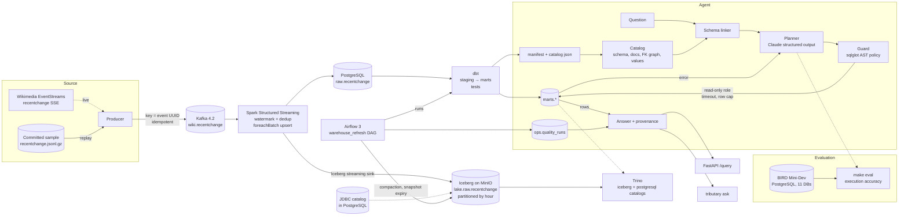

# Tributary: plan

A self-hostable streaming data platform with an analytics agent whose answers
are measured, not claimed. `docker compose up` brings up Kafka, a Spark
Structured Streaming ingest job, a PostgreSQL warehouse modelled with dbt,
an Apache Iceberg copy of the raw events on S3-compatible object storage
queried through Trino, Airflow orchestration with data-quality checks, and a
FastAPI serving layer.
On top sits a text-to-SQL agent that answers questions about the warehouse,
is graded on a public benchmark (BIRD Mini-Dev, PostgreSQL dialect, execution
accuracy) and is guarded against unsafe queries at the SQL-AST and database
level.

## Goal

**Problem.** Teams that collect event data want two things that rarely ship
together: a pipeline they can trust (no lost or duplicated events, checked
freshness and quality) and a way for non-SQL users to ask questions of the
result. Text-to-SQL products exist, but most sit on top of an unknown
warehouse, report accuracy from a slide deck, and treat "the model wrote
`DELETE`" as somebody else's problem. Vanna, the best known open-source
option, was archived in early 2026; Wren AI remains, built around a hosted
semantic layer. Nothing small, self-hostable and *measured* fills the gap
between "a Kafka tutorial" and "an enterprise BI product".

**Users.**
- Small engineering or analytics teams who already have an event stream and a
  Postgres box, and want a reference pipeline plus a question-answering API
  they can audit.
- Data engineers who want a complete, runnable example of the modern batch +
  streaming stack (Kafka, Spark, dbt, Airflow) with tests, not slides.
- Anyone building a text-to-SQL agent who wants a harness that grades it on
  BIRD Mini-Dev in PostgreSQL, with corrected labels, for a few dollars.

**The demo data is real.** The default source is the public Wikimedia
EventStreams feed of edits to every Wikipedia (`recentchange`): a genuine,
bursty, multi-language event stream with bots, reverts and late events. A
captured sample ships in the repo so everything is reproducible offline;
`--live` switches the producer to the real stream.

**What makes it impressive.**
1. **The hard part, named: trustworthy answers.** The agent's headline number
   is execution accuracy on BIRD Mini-Dev (500 questions, 11 databases,
   PostgreSQL dialect), reported on both the official labels and the
   corrected labels from the VLDB 2026 annotation-error study, with per-cost
   and per-latency figures, ablations (schema linking, execution-feedback
   repair, voting) and a 100%-or-fail safety suite. Every number comes from
   `make eval` and is recorded with its cost in RESULTS.md.
2. **A pipeline whose correctness is tested under failure.** `make bench`
   produces events with known ids, kills the Spark job and the broker
   mid-stream, restarts them, and asserts zero loss and zero duplicates in the
   warehouse, while measuring end-to-end latency and throughput.
3. **Answers carry provenance.** Each answer says which marts it read, when
   they were last refreshed, and whether their quality checks passed. Stale or
   failing tables are flagged in the answer, not hidden.
4. **It ships.** One Compose file, one pip package with a CLI
   (`tributary ask "..."`), typed code, CI, structured logs, read-only
   database roles, no secrets in the repo.

## Architecture

### Components

| Component | Directory | Technology | Role |
|---|---|---|---|
| Producer | `tributary/ingest/producer.py` | `confluent-kafka` (idempotent producer) | Replays the committed sample at a configurable rate, or reads the live Wikimedia SSE stream (User-Agent set, canary events dropped, resume with `Last-Event-ID`). Keys messages by the event's UUID. |
| Broker | `compose.yaml` | Apache Kafka 4.2 (KRaft, single node) | Topic `wiki.recentchange`, 3 partitions by default (`TRIBUTARY_TOPIC_PARTITIONS`). |
| Stream job | `tributary/stream/job.py` | PySpark 4.1 Structured Streaming (`local[N]`, N matched to the topic's partitions) | One Spark application, two streaming queries over the same Kafka source, each with its own checkpoint. **Warehouse query:** explicit JSON schema, event-time watermark, `dropDuplicatesWithinWatermark` on the event UUID, `foreachBatch` sink into `raw.recentchange` with `COPY` + `ON CONFLICT DO NOTHING`. **Lake query:** the same parse and dedup, written with Iceberg's native streaming sink to `lake.raw.recentchange`. |
| Object store | `compose.yaml`, `docker/minio/` | MinIO (built from its last tagged release, see Risks) | Bucket `lake` holding the Iceberg data and metadata files. S3 endpoint, keys and path-style access come from env, so any S3-compatible store can replace it. |
| Lakehouse table | `tributary/stream/lake.py` | Apache Iceberg 1.11 (`iceberg-spark-runtime-4.1_2.13`), Parquet, JDBC catalog in PostgreSQL | `lake.raw.recentchange`, format v2, partitioned by `hours(event_ts)`. The catalog is a schema in the existing PostgreSQL, so no extra service is needed for metadata. |
| Query engine | `docker/trino/` | Trino 484 (single node) | Catalogs `iceberg` (same JDBC catalog, S3 file IO on MinIO) and `postgresql` (the warehouse, read-only role). Used for the query-engine comparison and for federated queries that join lake events with warehouse marts. The agent does not use it. |
| Warehouse | `warehouse/` | PostgreSQL 17, dbt-core 1.12, dbt-postgres | Schemas `raw` → `staging` → `marts` (`fct_edits`, `dim_wiki`, `dim_page`, `agg_edits_hourly`, `agg_editor_activity`). dbt tests plus custom freshness and volume-anomaly tests. `manifest.json` + `catalog.json` are the agent's source of truth for table and column descriptions. |
| Orchestration | `orchestration/dags/` | Apache Airflow 3.3 (LocalExecutor) | `warehouse_refresh` (dbt run → dbt test → quality checks → publish catalog) on an asset schedule; `lake_maintenance` (Trino's Iceberg `optimize` on closed hours, `expire_snapshots`, `remove_orphan_files`) hourly when the `lakehouse` profile is up; `ops.quality_runs` records every check, including a Postgres-vs-Iceberg row-count reconciliation per closed hour. |
| Serving | `tributary/api/` | FastAPI, structlog, psycopg 3 | `/health`, `/catalog`, `/freshness`, `/sql` (guarded raw SQL), `/query` (question → SQL → rows → answer with provenance). API-key auth, request ids, per-key rate limit, Prometheus `/metrics`. |
| Agent | `tributary/agent/` | Anthropic SDK (`claude-opus-5-5` default), Ollama fallback, Fake provider for tests | `catalog.py` (schema + descriptions + FK graph + value index), `linker.py` (schema linking), `guard.py` (AST policy), `planner.py` (structured-output SQL draft + repair loop), `answer.py` (rows → answer + provenance). |
| CLI | `tributary/cli.py` | Typer | `tributary ask`, `sql`, `catalog`, `eval`, `bench`, `produce`. |
| Evaluation | `eval/` | pytest-style harness, sqlglot | BIRD Mini-Dev loader, execution-accuracy scorer, corrected-label track, schema-linking scorer, guard suite, cost ledger. |
| Benchmarks | `bench/` | Compose + Python driver | Fault-injection ingest benchmark and latency/throughput measurement. |

### Data flow



### The agent's query path

1. `Catalog.load()` reads dbt's `manifest.json` and `catalog.json` (or, for a
   plain database such as a BIRD schema, `information_schema` plus the
   benchmark's column-description CSVs) into tables, columns, types,
   descriptions, foreign keys and a small index of distinct values for
   low-cardinality text columns.
2. `link_schema(question, catalog, k)` returns the subset of tables and
   columns the planner should see. Baselines: `full` (everything) and `bm25`
   (lexical). The `core` strategy adds value matching and join-path
   expansion so the subset is connected.
3. `Planner.draft()` calls the model with a cached system prefix (dialect
   rules, the linked schema rendered as DDL with descriptions, a few
   examples) and the question, using structured output
   (`SQLDraft{sql, tables, assumptions, confidence}`), adaptive thinking and
   the fallback setting enabled.
4. `Guard.check(sql)` parses with sqlglot (PostgreSQL dialect) and rejects
   anything that is not a single `SELECT`/CTE, references schemas outside the
   allowlist, calls a blocked function (`pg_sleep`, `dblink`, `lo_*`, ...),
   or exceeds an `EXPLAIN` cost ceiling; it then injects `LIMIT` if missing.
5. Execution runs as the `tributary_reader` role with
   `default_transaction_read_only = on`, a statement timeout and a row cap.
   A database error is fed back to the planner for at most two repairs.
6. `answer.compose()` turns rows into a short answer and attaches the SQL,
   the tables read, each table's last refresh and its latest quality status.

### Key design decisions

| Decision | Chosen | Alternatives considered | Why |
|---|---|---|---|
| Warehouse engine | PostgreSQL 17 | DuckDB (fast analytics, single file); ClickHouse (columnar) | BIRD Mini-Dev ships PostgreSQL gold queries, so the benchmark and the product share one dialect and one guard. Postgres also hosts Airflow's metadata and supports concurrent writers. The cost is slower large scans; the demo scale (millions of rows) is fine, and the plan records this as a known limit. |
| Streaming engine | Spark Structured Streaming in local mode | A plain Python consumer; Kafka Streams; Flink | Spark is a target skill and gives watermarks, stateful dedup and checkpoint recovery for free. Local mode in one container keeps Compose light; the job is written against the same API a cluster would use. A Python consumer would be simpler but would re-implement exactly these semantics by hand. |
| Exactly-once | Idempotent sink keyed by the event UUID, plus Kafka idempotent producer and Spark checkpoints | Kafka transactions end to end | Transactions do not reach PostgreSQL; an idempotent `ON CONFLICT DO NOTHING` sink gives effectively-once delivery that survives any crash point, and the fault-injection benchmark proves it instead of asserting it. |
| Lakehouse layer | Raw events also written as an Iceberg table (Parquet) on object storage | Delta Lake; Hudi; Parquet files without a table format | Iceberg has hidden partitioning (`hours(event_ts)` without a derived column, so queries filtering on the timestamp prune), snapshot isolation, and first-class support in both Spark and Trino. Plain Parquet would leave commits, schema evolution and pruning metadata to hand-written code. Delta's Trino support is good too, but Iceberg is the engine-neutral choice. |
| Writing two sinks | Two streaming queries in one Spark application, separate checkpoints; Iceberg's native streaming sink for the lake | One `foreachBatch` that writes both | Iceberg's streaming sink records the query id and batch id in each snapshot and skips a batch it has already committed, so a replayed micro-batch does not duplicate rows. A dual write inside one `foreachBatch` would need `MERGE INTO` on the event id to stay idempotent (a full-table join per batch) and would couple the two sinks' failures. The cost is reading Kafka twice; the bench measures it. |
| Iceberg catalog | JDBC catalog stored in the existing PostgreSQL | Iceberg REST catalog (Polaris, Lakekeeper); Hive Metastore; Nessie | Spark and Trino both support the JDBC catalog, and it adds no service: commits are row updates under PostgreSQL's transactions. A REST catalog is the production direction (credential vending, multi-engine governance) and is noted in the roadmap. |
| Query engine | Trino over Iceberg and PostgreSQL | Spark SQL (Thrift server); DuckDB with the Iceberg extension | Trino is what data platform teams run for interactive SQL over a lake, and its connectors make the Postgres-vs-lake comparison and federated joins possible from one SQL endpoint. DuckDB would be faster on one box but has no PostgreSQL-catalog federation story at the same level, and Spark SQL's start-up latency is a poor fit for interactive queries. |
| Agent's engine | PostgreSQL only; Trino is not exposed to the agent | Let the agent choose an engine | One dialect keeps the guard, the benchmark and the product aligned. A Trino dialect for the guard is a stretch goal (see Milestones). |
| Transform layer | dbt-core 1.12 with dbt-postgres | Spark SQL batch jobs; hand-written SQL in Airflow tasks | dbt gives tests, docs and lineage as data; the agent reads the manifest and catalog directly, so column descriptions written once serve both humans and the model. dbt Fusion (2.0) is still pre-release and was not chosen. |
| Orchestrator | Airflow 3.3 with assets and the Task SDK | Dagster; Prefect; cron | Airflow is the posting keyword and 3.x assets map cleanly onto "refresh when raw data changed". |
| Data quality | dbt tests plus two custom tests (freshness, volume z-score), results persisted to `ops.quality_runs` | Great Expectations; Soda Core | Both frameworks add a second DSL and a service; the checks needed here are a few SQL statements, and persisting results to a table is what makes provenance possible. |
| Agent model | `claude-opus-5-5` default, pluggable provider (`anthropic`, `ollama`, `fake`) | A fine-tuned open text-to-SQL model | A general model plus good grounding is the realistic production choice; Ollama (`qwen2.5-coder`) keeps the offline path alive and gives a second column in the results table. |
| Safety | Defence in depth: AST policy, read-only role, statement timeout, row cap, schema allowlist | Prompt instructions only; regex deny-list | Regexes miss comments, CTEs and function calls; the AST policy is testable against an adversarial suite and the database role catches whatever the parser misses. |
| Benchmark | BIRD Mini-Dev (PostgreSQL), official and corrected labels | Spider 1.0 (SQLite, saturated); Spider 2.0 (BigQuery/Snowflake accounts) | Mini-Dev is the only major benchmark with PostgreSQL gold, is small enough to run for dollars, and has a published corrected label set, so the label-noise problem (52.8% error rate reported) can be measured rather than ignored. |
| Schema linking | A pluggable strategy with measured baselines | Always send the full schema | Full schema is the baseline and often wins on small databases; linking is what scales to real warehouses, and the eval shows exactly when it helps or hurts. |
| Demo source | Wikimedia `recentchange`, committed sample by default | Synthetic e-commerce generator | Real data has the warts (bots, bursts, Unicode, late events) that make the pipeline worth testing. The sample keeps `comment` text out (CC BY-SA) and keeps factual fields only. |

### Repository layout

```
tributary/            package: ingest/, stream/, agent/, api/, cli.py, config.py, logging.py
warehouse/            dbt project (models, tests, macros, seeds)
orchestration/dags/   Airflow DAGs
eval/                 benchmark loaders, scorers, recorded fixtures, results
bench/                ingest fault-injection and latency benchmark
data/sample/          captured recentchange sample (gzip JSONL)
docker/               Dockerfiles (app, spark, airflow, minio) and Trino catalog config
docs/                 architecture notes, screenshots, demo GIF
tests/                unit and integration tests
compose.yaml, Makefile, pyproject.toml, RESULTS.md, RELEASE.md
```

## Evaluation

### Datasets

| Dataset | Size | Dialect | Licence | Use |
|---|---|---|---|---|
| BIRD Mini-Dev, official (`birdsql/bird_mini_dev`, `mini_dev_postgresql.json` + `BIRD_dev.sql` dump) | 500 questions, 11 databases; 30% simple, 50% moderate, 20% challenging | PostgreSQL | CC BY-SA 4.0 | Headline execution accuracy. Downloaded by `make bird`, never committed. If the PostgreSQL dump is unavailable, the loader converts the SQLite databases and verifies every gold query executes. |
| BIRD Mini-Dev, corrected (`uiuc-kang-lab/text_to_sql_benchmarks`, `arcwise_plat_sql_only_with_diff.json`) | 498 questions, same databases | SQLite gold, transpiled to PostgreSQL with sqlglot and execution-verified | CC BY-SA 4.0 | Second track. Items whose transpiled gold fails to execute are dropped and the count is reported. |
| Guard suite (`eval/guard/`) | about 60 unsafe statements (DML, DDL, `pg_sleep`, `COPY`, `dblink`, stacked statements, comment tricks, `information_schema` probes) + the 500 gold queries as the benign set | PostgreSQL | repo | Safety: block rate and false-block rate. |
| Ingest benchmark | 50,000 sample events with known ids | n/a | derived from Wikimedia data (factual fields only) | Exactly-once and latency under fault injection. |
| Warehouse question set (`eval/warehouse_questions.yaml`) | 40 questions about the demo marts with hand-checked SQL | PostgreSQL | repo | Sanity check that the product works on its own data; also the demo script. |

### Metrics and how each number is measured

| Number | Metric | Command | Method |
|---|---|---|---|
| Execution accuracy (EX) | Fraction of questions whose predicted SQL returns the same multiset of rows as the gold SQL (BIRD semantics: order-insensitive, duplicates kept), with a Wilson 95% interval | `make eval` | Both queries run on the same database with a 30 s timeout; an implementation of the official scorer is cross-checked against the official `evaluation_ex.py` on a recorded subset. Reported per difficulty, per track (official, corrected) and per variant. |
| Ablations | EX for `full`, `bm25`, `core` linking × {no repair, repair} × {single, vote-of-3} | `make eval VARIANT=...` | Same harness; each variant's cost and p50/p95 latency are logged from `usage` in the API response. |
| Model comparison | EX for `claude-haiku-5-5` (all variants), `claude-opus-5-5` (best variant, 200-question stratified subset), Ollama `qwen2.5-coder:7b` (best variant, hardware permitting) | `make eval MODEL=...` | Same harness. |
| Schema-linking quality | Table recall@k and precision against gold tables (parsed from gold SQL with sqlglot); column recall | `make eval-link` | Offline, no model calls; runs in CI. |
| Guard | Block rate on the unsafe suite (must be 100%); false-block rate on 500 gold queries (target 0%) | `make eval-guard` | Offline; runs in CI. |
| Exactly-once | Events produced vs distinct rows in `raw.recentchange` after killing and restarting the Spark job and the broker mid-stream (3 crash points, 3 repetitions) | `make bench` | Compose on a 4-vCPU machine; duplicates and losses must be 0. |
| Latency and throughput | End-to-end p50/p95 from produce time to warehouse insert time; sustained events/s at steady state | `make bench` | Same run, timestamps stamped by the producer and the sink. |
| Freshness and quality | Share of `warehouse_refresh` runs with all checks passing over the bench run; freshness lag p95 | `make bench` | Read from `ops.quality_runs`. |
| Cost | Dollars per question per variant, from token usage and the published price list | `make eval` | Written next to each EX figure in RESULTS.md. |

### Baselines and reference points

- The zero-shot `full` schema variant with no repair is the baseline every
  other variant must beat or explain.
- Published Mini-Dev leaderboard figures are SQLite results from 2024-era
  models and are cited as context, not as a comparison row.
- Label noise is handled by reporting both tracks; the delta between them is
  itself a result.

### Cost plan

Haiku 5.5 at $0.10/$0.50 per million tokens with a cached schema prefix:
about $0.40 per 500-question variant, roughly $3 for the full ablation grid.
One Opus 5.5 pass on the 200-question subset: about $7. Total under $12. If
no key is available the harness runs on recorded responses and RESULTS.md
lists the exact commands under "To measure".

## Release

**How users get it.**
- `pip install tributary` gives the CLI and the agent; `tributary ask` works
  against any PostgreSQL URL plus a dbt manifest, and against a running
  Tributary API.
- `git clone` + `docker compose up` brings up the platform with the sample
  data flowing within two minutes, including MinIO and the Iceberg sink;
  profile `lakehouse` adds Trino (about 2 GB of heap, so it is opt-in),
  profile `airflow` adds the scheduler and web UI, profile `bird` loads the
  benchmark databases.
- A GitHub Container Registry image for the API and the Spark job, built on
  tags.

**What the maintainer must provide.**
- `ANTHROPIC_API_KEY` as a repository secret: enables the `integration` and
  `eval-live` CI jobs (both skipped without it).
- PyPI trusted publishing for the `tributary` project (or a `PYPI_API_TOKEN`
  secret) before the first tag; the release workflow is guarded by
  `if: startsWith(github.ref, 'refs/tags/v')` and does nothing otherwise.
- GHCR needs no secret beyond the default `GITHUB_TOKEN` with `packages:
  write`.
- No hosted demo: the platform needs a broker and a JVM, so the README demo
  is a GIF of `docker compose up` followed by `tributary ask`.

RELEASE.md will carry the exact steps.

## Risks

| Risk | Mitigation |
|---|---|
| CI cannot run Kafka + Spark + Postgres + Airflow quickly | Unit tests mock everything; one integration job uses Compose with the `platform` profile only (no Airflow) and a 5,000-event replay; Airflow DAGs are tested with `dag.test()` against Postgres only. |
| BIRD PostgreSQL dump is distributed through a Google Drive package that may be rate-limited | Loader prefers the Hugging Face files; fallback converts the SQLite databases to PostgreSQL and verifies each gold query executes; the loader caches under `~/.cache/tributary`. |
| Label noise makes EX hard to interpret | Two tracks (official, corrected) reported side by side; item-level diffs kept in `eval/results/`. |
| sqlglot cannot parse some valid PostgreSQL | The guard fails closed (unparseable = blocked) and the false-block rate on 500 gold queries measures the cost of that choice. |
| Spark local mode on a 4-vCPU box starves Postgres | Trigger interval and `maxOffsetsPerTrigger` are configurable; the bench records the settings used. |
| MinIO's upstream repository was archived in April 2026 and `minio/minio` is no longer on Docker Hub (checked 2026-10-16; last release `RELEASE.2025-10-15T17-29-55Z`) | `docker/minio/Dockerfile` builds that tagged release from source in a multi-stage build, so the image is reproducible and pinned. The store is reached only through S3 settings (endpoint, keys, path-style), and the M2 integration test runs against whichever store is configured, so swapping to SeaweedFS (Apache 2.0, active) is a config change. The swap is made if the source build fails or a security issue appears. |
| Iceberg streaming writes produce many small files (one or more per partition per micro-batch) | `lake_maintenance` compacts closed hours with `optimize` and expires snapshots; the query comparison reports file counts and latency before and after compaction. |
| Trino plus Spark plus Kafka plus Postgres exceed a laptop's memory | Trino is in the `lakehouse` profile with a fixed heap; Compose sets memory limits per service, and RESULTS.md records them with every benchmark. |
| PyPI `pyspark` version drifts from the `apache/spark` image | The Spark job container is built from the `apache/spark:4.1.x-python3` image and pins the matching `pyspark`; the rest of the package never imports pyspark. |
| Wikimedia stream terms (small-scale tools only) | Live mode is opt-in, sets a descriptive User-Agent, reconnects with backoff, and is never used in CI. |
| Model cost or key unavailable | Fake provider with recorded responses for CI; live evals sized to under $12 total; cost printed per run. |
| Provider API drift | Single `provider.py` boundary; integration test pinned to the SDK version in `pyproject.toml`. |

## Milestones

- [ ] M1: Scaffold, CI and the ingest spine — `uv` project with ruff, mypy strict, pytest and a GitHub Actions workflow; `compose.yaml` with PostgreSQL 17 and Kafka 4.2 (KRaft); the committed 50,000-event sample; the producer with replay and `--live`; the Spark Structured Streaming job writing `raw.recentchange` with watermark, dedup and the idempotent sink; `tributary produce` and `tributary stream` commands; structured logging and env config. Done when `docker compose up` shows rows landing in `raw.recentchange`, an integration test replays 5,000 events through Kafka and Spark into Postgres in CI and asserts the count, and unit tests pass offline.
- [ ] M2: Warehouse, lakehouse and orchestration — dbt project (`staging`, `marts`, seeds, generic and custom tests for freshness and volume anomaly), `warehouse_refresh` Airflow 3 DAG with assets, `ops.quality_runs`, catalog export (`manifest.json` + `catalog.json` + value index) to a known path, Compose profile `airflow`. The lakehouse: MinIO image built from source, the Iceberg JDBC catalog in PostgreSQL, the second streaming query writing `lake.raw.recentchange` (partitioned by `hours(event_ts)`), Trino in profile `lakehouse` with `iceberg` and `postgresql` catalogs, the `lake_maintenance` DAG and the per-hour reconciliation check. Done when `dbt build` passes on the sample, both DAGs run green under `dag.test()` in CI, quality results land in `ops.quality_runs`, an integration test replays 5,000 events and asserts the same distinct-id count from PostgreSQL directly and from Trino over Iceberg, `EXPLAIN` in Trino shows an hour filter reduced to one partition, and a dbt docs screenshot is in `docs/`.
- [ ] M3: Agent core and serving — `Catalog` (dbt and information_schema loaders), `Guard` with the AST policy, read-only role and timeouts, the adversarial guard suite, provider boundary (`anthropic` with structured outputs, prompt caching, fallbacks and usage accounting; `ollama`; `fake` with recordings), `Planner` with the repair loop, `answer.py` with provenance, FastAPI `/query`, `/sql`, `/catalog`, `/freshness` with API-key auth and request ids, `tributary ask`. Done when `make eval-guard` blocks 100% of the suite with 0 false blocks on the warehouse question set, the 40 warehouse questions answer correctly on the fake provider from recordings, and the API tests pass.
- [ ] M4: Benchmark harness and schema linking — `make bird` (loader with cache and SQLite fallback), execution-accuracy scorer cross-checked against the official script, the corrected-label track with transpilation and verification, `make eval` with variants, models and the cost ledger writing `eval/results/*.json` and RESULTS.md tables; the `link_schema` interface with `full` and `bm25` baselines, `make eval-link` with table recall and precision, and a `core` strategy stub behind a flag. Done when `make eval` runs end to end on recorded Haiku responses for a 50-question subset in CI, `make eval-link` reports recall for both baselines, and RESULTS.md lists every live command with its estimated cost.
- [ ] M5: Ingest reliability benchmark — `make bench` driver: produce 50,000 keyed events, kill the Spark job and then the broker at three points, restart, assert zero loss and zero duplicates, measure p50/p95 end-to-end latency and sustained throughput, record Compose resource settings; backpressure and trigger tuning from the results; freshness lag from `ops.quality_runs`. Done when RESULTS.md holds the measured table from a real run on this machine class, with raw output committed under `bench/results/`.
- [ ] M6: Agent quality — value retrieval (literal matching against the value index), few-shot examples drawn from dbt docs, self-consistency voting by result hash, the `core` linking strategy wired in and measured; the full ablation grid on Haiku 5.5 and the Opus 5.5 subset run if a key is present, otherwise recorded; failure analysis of 30 wrong answers by category. Done when RESULTS.md has the ablation table (both tracks) with cost and latency per variant and the failure taxonomy, and the chosen default variant is justified by the numbers.
- [ ] M7: Release readiness — README with demo GIF, architecture diagram, design decisions, results table and roadmap; RESULTS.md complete with "To measure" for anything unrun; RELEASE.md; PyPI build and guarded publish workflow; GHCR image workflow; Dockerfile hardening (non-root, pinned digests); security pass on the API and the guard; CHANGELOG; version 0.1.0 tag prepared but not pushed. Done when a clean-checkout `pip install .` plus `docker compose up` reproduces the README quickstart, every CI job is green, and the release workflow dry-runs on a branch.
