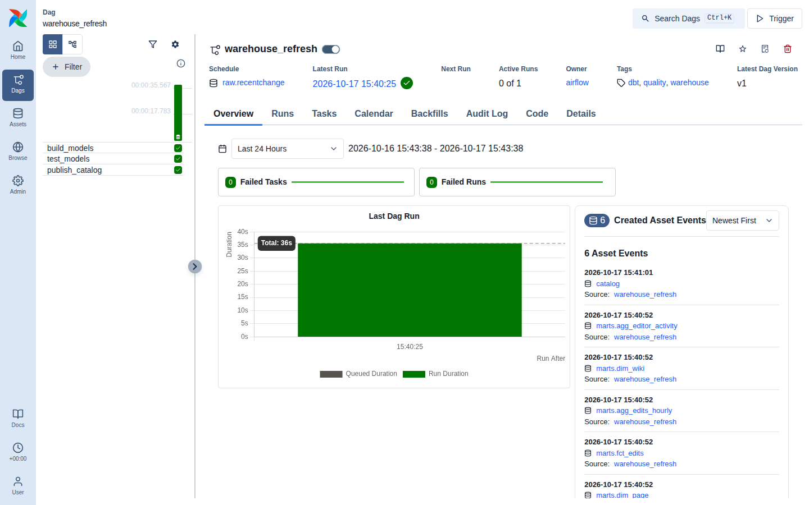
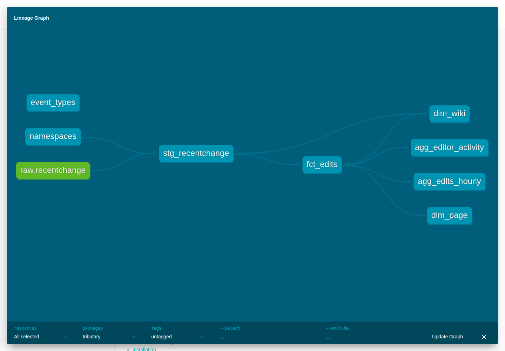
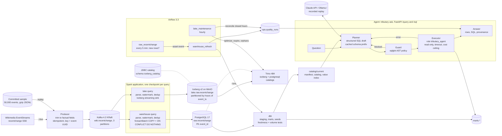
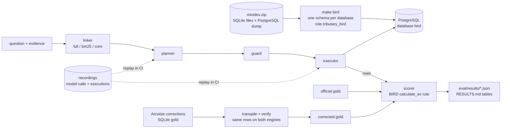

# Tributary

Streaming data platform with an evaluated analytics agent.

Tributary ingests an event stream through Kafka into a PostgreSQL warehouse
with Spark Structured Streaming, keeps an Apache Iceberg copy of the raw
events on object storage for Trino, models the warehouse with dbt under
Airflow with data-quality checks, serves it through FastAPI, and answers
questions about it in plain English with a text-to-SQL agent that is graded
on BIRD Mini-Dev (execution accuracy, PostgreSQL) and guarded against unsafe
queries. The demo data is the live Wikipedia edit stream; one
`docker compose up` brings the pipeline up with a committed sample.

**Status: the pipeline, the guarded agent and its benchmark harness work, the
ingest path is measured under failure and at scale, and the warehouse and the
lake are timed against each other (milestone 6 of 8).**
Kafka feeds one Spark application with two streaming queries: one into the
PostgreSQL warehouse, modelled with dbt, and one into an Iceberg table on
MinIO, queried with Trino. Airflow rebuilds the marts when new rows land,
records every quality check in `ops.quality_runs`, publishes the catalog,
and keeps the lake reconciled with the warehouse hour by hour. On top,
`tributary ask` and a FastAPI service turn a question into SQL with a model
(Claude by default, a local Ollama model offline), pass it through an AST
guard and a read-only database role, and answer with the rows, the SQL and
each table's freshness and quality status. `make bird` loads BIRD
Mini-Dev into PostgreSQL and `make eval` grades the agent on it by
execution accuracy, on the official and the corrected labels, from
recordings that CI replays without a model or a database. `make bench` kills
the stream job and the broker mid-batch and checks every event landed once in
both stores; `make bench-scale` measures throughput at 1, 3 and 6 partitions
and names what limits it; `make bench-query` times ten queries on PostgreSQL,
Trino over PostgreSQL and Trino over Iceberg at 1M and 20M rows. Measured numbers live in [RESULTS.md](RESULTS.md).

## Why

Teams that collect event data want a pipeline they can trust (no lost or
duplicated events) and a way to ask questions of the result. The pipeline
half has to be correct under retries, restarts and late data before any
question about it is worth answering, so that is where this starts.

## Quickstart

Requirements: Docker with Compose v2. For the host commands: Python 3.12 and
[uv](https://docs.astral.sh/uv/); Java 17 only to run Spark on the host.

```bash
docker compose up -d --build        # Kafka, PostgreSQL, MinIO, the stream job, a one-shot sample replay
docker compose logs -f producer stream
docker compose exec postgres psql -U tributary -c \
  "SELECT wiki, count(*) FROM raw.recentchange GROUP BY 1 ORDER BY 2 DESC LIMIT 5"
```

The producer replays the 50,000-event sample at 500 events/s into both
sinks. Add the query engine and the orchestrator with profiles:

```bash
docker compose --profile lakehouse up -d    # Trino on localhost:8081
docker compose exec trino trino --execute \
  "SELECT date_trunc('hour', event_ts) AS hour, count(*) FROM iceberg.raw.recentchange GROUP BY 1"
docker compose --profile airflow up -d      # Airflow UI on http://localhost:8080
```

With the `airflow` profile up, `raw_recentchange` notices new rows within five
minutes and triggers `warehouse_refresh` (dbt build, tests, quality results,
catalog); `lake_maintenance` runs hourly.



The same steps run by hand from the host:

```bash
uv sync --all-extras
uv run tributary warehouse refresh                 # dbt seed+run, dbt test -> ops.quality_runs, publish the catalog
uv run tributary lake reconcile                    # closed hours, warehouse vs lake -> ops.quality_runs
uv run tributary lake pruning 2026-10-16T23        # does a one-hour filter read only that hour's files?
uv run tributary lake maintain                     # compact closed hours, expire snapshots, remove orphans
```

From the host, for the ingest side:

```bash
uv sync --all-extras
uv run tributary produce --limit 1000 --rate 0     # replay part of the sample, unthrottled
uv run tributary produce --live                    # the real Wikimedia stream (Ctrl-C to stop)
uv run tributary sample stats                      # what the sample looks like, incl. lateness
uv run tributary stream --available-now            # run the Spark job on the host until caught up
```

Ask the warehouse a question (after `tributary warehouse refresh` has
published a catalog; with `ANTHROPIC_API_KEY` set, or `--provider ollama`
with a local model):

```bash
uv run tributary warehouse grant-agent             # the agent's read-only role, once per database
uv run tributary ask "Which 5 wikis had the most edits? Return the wiki and its number of edits."
uv run tributary sql "SELECT count(*) FROM fct_edits WHERE is_bot"   # same guard and role, no model
uv run tributary catalog --relation marts.fct_edits                  # the schema the model sees
```

```text
This query selects the top 5 wikis with the most edits from the dim_wiki table, ordering the
results by the 'edits' column in descending order and limiting the output to 5 rows. 5 rows: wiki
wikidatawiki, edits 9,745; wiki enwiki, edits 4,564; wiki commonswiki, edits 4,047; wiki
kuwiktionary, edits 722; wiki zhwiki, edits 636.

SQL:
  SELECT wiki, edits FROM marts.dim_wiki ORDER BY edits DESC LIMIT 5

wiki          edits
------------  -----
wikidatawiki  9745
enwiki        4564
commonswiki   4047
kuwiktionary  722
zhwiki        636

Provenance:
  marts.dim_wiki: rebuilt 2026-10-17T23:06:31.587522+00:00, quality pass (38 checks)

qwen2.5-coder:7b, 1 attempt(s), 2614 in / 109 out tokens, $0.0, 236555.6 ms
```

(A run with `--provider ollama` and `qwen2.5-coder:7b` on CPU, the first call
of a cold model; the explanation is the model's, written before it saw any
rows, and every number after it comes from the result.) The same over HTTP:

```bash
export TRIBUTARY_API_KEYS=$(python -c "import secrets; print(secrets.token_urlsafe(32))")
make up-api                                        # or: uv run tributary serve
curl -s localhost:8000/query -H "X-API-Key: $TRIBUTARY_API_KEYS" \
  -H 'content-type: application/json' -d '{"question": "How many page creations are there?"}'
uv run tributary ask --api http://localhost:8000 --api-key "$TRIBUTARY_API_KEYS" "..."
```

`/query` (question → answer), `/sql` (guarded SQL), `/catalog` and
`/freshness` need the key; `/health` does not. `make up-api` starts the
Airflow profile as well, because the API reads the catalog that
`warehouse_refresh` publishes: until that DAG has run once (or `uv run
tributary warehouse refresh` has), `/query` answers 503.

Benchmark the ingest path (each run recreates containers and wipes the landing
table, so use a stack you can throw away; results go to `bench/results/`):

```bash
make bench          # SIGKILL the job and the broker, check exactly-once in both stores, tune, freshness (~1 h)
make bench-scale    # sustained events/s, p95 and the bottleneck at 1, 3 and 6 partitions (~2 h)
make bench-results  # re-render RESULTS.md's ingest tables from bench/results/
```

Grade the agent on BIRD Mini-Dev (PostgreSQL alone is enough):

```bash
make eval                                   # replay the recorded dev50 run: no model, no database
docker compose up -d postgres && make bird  # 800 MB download once, then about a minute
docker compose --profile ollama up -d ollama
docker compose exec ollama ollama pull qwen2.5-coder:7b
make eval PROVIDER=ollama MODEL=qwen2.5-coder:7b          # live, about 70 min on 4 CPUs
ANTHROPIC_API_KEY=... make eval PROVIDER=anthropic MODEL=claude-haiku-5-5 RECORD=1
make eval-link                              # schema-linking recall, offline
```

Demo: *screenshot placeholder.* To capture one, run the commands above and
record `docker compose logs -f stream` next to the `psql` query (for example
with `asciinema rec` and `agg`), saved as `docs/demo.gif`.



## Architecture



**The hard part: every event exactly once, under retries, restarts and late
data.** No single layer can promise that on its own, so each one covers a
different failure:

| Failure | What handles it |
|---|---|
| Producer retries after a lost ack | Kafka's idempotent producer (`enable.idempotence`, `acks=all`): the broker drops the retried copy. |
| The same event sent twice (re-run, live-stream reconnect) | `dropDuplicatesWithinWatermark` on the event UUID, keyed in Spark's state store. A copy arriving after its key expired is normally behind the watermark and dropped as late; if the watermark jumped by more than the delay in one batch (after an outage) it passes as a new key, and then the primary key below stops it (both cases pinned by a test). |
| A micro-batch replayed after a crash between the sink's write and Spark's commit | The sink: `COPY` into a temp table, then `INSERT ... ON CONFLICT (event_id) DO NOTHING`. Writing the same batch twice is a no-op. Spark's state cannot help here: the replay re-runs the batch from the previous state. |
| Offsets lost or truncated in Kafka | `failOnDataLoss=true`: the job stops instead of silently skipping. |
| Events that arrive late | The watermark delay (10 min) is chosen from the measured lateness of the real stream: p99 8 s, max 143 s over 50,000 events, 0 that a 10-minute delay would drop. Rows dropped by the watermark are logged per batch. |
| A poison message (bad JSON, bad UUID, a timestamp past year 9999, a NUL byte in a text field) | Counted as malformed and filtered before the sink, so one bad record cannot fail every replay of its batch. |

Kafka transactions cannot reach PostgreSQL, so end-to-end exactly-once here
means at-least-once delivery into an idempotent sink. **That claim is tested
where it can break.** A Spark micro-batch logs its offsets before it runs and
its commit after the sink returns; a restart re-runs any batch in between.
Killing the job at random mostly lands between batches and proves nothing,
so `make bench` aims each SIGKILL at that window. It polls PostgreSQL every
2 ms for the moment the warehouse sink has written batch N, or the Iceberg
catalog has committed it, then kills the container through its cgroup
(`docker kill` was too slow: Spark committed first every time) and reads the
checkpoint afterwards to prove the batch was logged but not committed. Over
nine 50,000-event runs, with the job killed nine times (six aimed and
confirmed in the checkpoint, three at an arbitrary point in a batch) and the
broker nine times:
- no acknowledged event was lost in PostgreSQL or in Iceberg, and none was
  duplicated in Iceberg (in PostgreSQL the primary key makes a duplicate
  impossible, so the test there is loss and the replay);
- each replay of an already-written batch was absorbed by the primary key
  (about 1,000 rows per replay);
- each replay of an already-committed lake batch was skipped by Iceberg:
  exactly one snapshot carries its batch id.

**The lake copy has no primary key, so it is checked instead.** The Iceberg
query runs the same parser and dedup with its own checkpoint, and Iceberg's
streaming sink records the query id and batch id in each snapshot and skips
a batch it has already committed, so a replayed micro-batch does not append
twice. What it cannot absorb is a duplicate that got past the dedup state.
The `lake_maintenance` DAG therefore compares every *closed* hour (one the
watermark has passed, so neither sink will receive another row for it):
distinct ids in PostgreSQL against rows and distinct ids in Iceberg, one
`ops.quality_runs` row per hour. An hour is closed on the newest event of the
warehouse's *fully committed* batches (the sink records each in
`ops.stream_progress`), because a batch commits partition by partition and the
table's own maximum can run ahead of rows still being written. The two
queries trigger at different rates, so an event later than the watermark
delay could be kept by one and dropped by the other; the hour's details say
which kind of mismatch it was. A lake that has stopped would close no hours
and pass silently, so a separate `lake_lag` check fails when the lake's
newest event trails the warehouse's by more than 15 minutes. On the sample
the closed hour matched (19,271 = 19,271, 0 duplicates); with one row copied
into the lake a second time, the check failed with `lake_duplicates = 1`.

**Partitioning is measured, not assumed.** `tributary lake pruning HOUR` runs
`EXPLAIN ANALYZE` on a one-hour filter and compares what the scan read with
the table's `$files` metadata: on the sample, the 23:00 hour is 2 files and
19,271 rows of the table's 4 files and 50,000 rows, and the scan read 2
splits and 19,271 rows. The integration test asserts the same on every run.

One consequence of event-time processing to know before replaying data by
hand: the watermark only moves forward. Once the job has seen events from
time *T*, anything older than *T* − 10 min is dropped as late, so replaying an
old file into a stack that has already ingested newer events loses it. Start
from `make down` (which deletes the checkpoint) to replay from scratch.

### Two engines over the same events: where each wins

The warehouse (a PostgreSQL row store) and the lake (Iceberg's columnar files
on object storage, read by Trino) hold the same events, so `make bench-query`
asks which to use for what. It scales the sample to 1M and 20M rows (copies
shifted in time, so the distributions stay real), writes the same rows to both
stores in one Spark job, and times ten queries on PostgreSQL, Trino over its
PostgreSQL catalog and Trino over Iceberg, warm and cold. A time only counts if
the engine's rows equal PostgreSQL's. Full tables in
[RESULTS.md](RESULTS.md#query-engines-postgresql-vs-trino-over-iceberg-m6).

- **Trino over Iceberg wins whole-table aggregates once the data outgrows
  memory: 5.5–18x over PostgreSQL at 20M rows** (counts per wiki in 0.54 s
  against 8.4 s). The row store is 4.6 times the size of the Parquet files
  (4.4 GB against 958 MB) and does not fit in its 4 GB, so its scans read
  whole rows; Trino reads only the columns the query names, compressed, in
  parallel (and answers a bare `count(*)` from the files' metadata without
  reading data). At 1M rows PostgreSQL wins the cheap aggregates, because no
  Trino over Iceberg query took less than about 80 ms (planning, scheduling,
  opening files), and these take PostgreSQL 83–136 ms.
- **PostgreSQL wins point lookups by three orders of magnitude** (0.3 ms
  against 1 s at 20M): it has a primary key, and Iceberg has no index, so Trino scans
  the id column of every file.
- **Narrow time windows are close, PostgreSQL mostly**, because a BRIN index
  on `event_ts` is its partitioning: the heap is in time order, so one hour is
  3,353 of 534,112 blocks and costs 47 ms at 20M, no more than at 1M (Trino:
  130 ms). The other one-hour query is a tie (94 against 106 ms, inside the
  spread of repeated runs at this size). A six-hour window flips to Trino
  (89 ms against 514 ms at 20M), since PostgreSQL reads whole rows.
- **Trino over PostgreSQL is a federation tool, not a faster PostgreSQL.** It
  pushes filters and simple aggregates down and adds its own overhead; it beat
  PostgreSQL directly on one query of ten and was never the fastest engine. Its worst case was not Trino's cost: the connector's sessions run
  with PostgreSQL's default 4 MB `work_mem`, under which the planner chose a
  sequential scan for a filter it answers with BRIN at 64 MB (10.5 s against
  0.3 s when run by hand, and 0.2–0.4 s with `work_mem` alone changed).
- **Compaction matters more than partitioning at this scale.** Partitioned by
  hour, one hour is one 4 MB file, of which Trino reads 0.6 MB, and costs
  80 ms at 1M and at 20M. In the layout the streaming sink leaves (a 36 kB
  file per trigger, task and hour), pruning still finds the right 183 files
  but the query reads 7–11 times the bytes and runs 3–10 times slower. Without partitioning (one unsorted file), Parquet's
  columns keep a full scan of 20M rows at 0.3–0.4 s, 3.5–4.8 times the
  partitioned table, and it grows with the table.
- **One failure, reported rather than tuned away.** Trino has no exact
  percentile aggregate, so the 95th-percentile query ranks every row per wiki
  in a window. At 20M that buffers about 6M rows for one wiki and exceeds
  Trino's 739 MB per-node query memory on both Trino engines. PostgreSQL sorts
  with spill to disk and answers in 23 s.

The lake and the warehouse also meet in one query. Trino joins the Iceberg
events with `marts.dim_wiki`, which dbt builds in PostgreSQL, and its result
equals the same join run inside PostgreSQL (155 ms at 20M):

```sql
SELECT d.project_family, count(*) AS events, count(DISTINCT e.wiki) AS wikis
FROM iceberg.bench.events_20m AS e
JOIN postgresql.marts.dim_wiki AS d ON d.wiki = e.wiki
WHERE e.event_ts >= TIMESTAMP '2026-10-22 00:00:00 UTC'
  AND e.event_ts <  TIMESTAMP '2026-10-22 01:00:00 UTC'
GROUP BY d.project_family
ORDER BY events DESC, d.project_family
```

| project_family | events | wikis |
|---|---|---|
| wikipedia | 31,344 | 105 |
| commons | 26,323 | 1 |
| wikidata | 16,439 | 2 |
| wiktionary | 7,954 | 20 |
| wikisource | 465 | 10 |

(top 5 of 15 rows)

### The agent: an answer you can check

**The hard part on the agent side is trusting an answer, which takes four
things the model alone cannot give:** the query must be unable to do harm,
it must read only what it is allowed to, a failure must be something the
model can fix, and the answer must say what it rests on. Each layer is
there because the one before it can be wrong:

| Layer | What it does | What it would miss alone |
|---|---|---|
| Planner (`tributary/agent/planner.py`) | The model sees the marts as DDL with dbt's descriptions, keys, lineage and indexed values (the system prefix, cached), and returns a schema-enforced `SQLDraft`. A guard block or PostgreSQL error goes back as the next turn, at most two repairs. | A model can write anything, including `DELETE`. |
| Guard (`tributary/agent/guard.py`) | Parses with sqlglot and fails closed: one `SELECT`, no write or DDL node anywhere in the tree (a `DELETE` hidden in a CTE included), only the catalog's relations (unqualified names are qualified on the way out), an allowlist for functions sqlglot does not know and a denylist for dangerous ones, `LIMIT` capped. The SQL that runs is regenerated from the checked tree, so comments and anything the parser dropped never reach the database. 112 attack statements, all blocked; 40 gold queries, none blocked. | A parser can disagree with PostgreSQL. |
| Database (`tributary/agent/execute.py`, `roles.py`) | Role `tributary_agent`: SELECT on marts and `ops` only, read-only sessions by default. Each query: its own connection, a prepared statement (one statement, enforced by the protocol), `READ ONLY` transaction, statement timeout, empty `search_path`, `EXPLAIN` cost ceiling, row cap. With the guard switched off it still refuses 90 of the 112 attacks. | Catalog reads, `set_config`, sleeping and signalling its own sessions are open to any role: the 22 the guard alone stops. |
| Answer (`answer.py`, `provenance.py`) | The text is composed from the rows (the model never restates a number), and carries the SQL that ran, the tables read and, for each, its last successful rebuild and the latest result of every check on it and on its sources. Stale or failing tables become warnings in the answer text. | A correct query over a stale or broken table is still a wrong answer. |

The model boundary (`tributary/agent/provider.py`) is one request shape and
three providers: `anthropic` (structured outputs, prompt caching on the
schema prefix, server-side fallback on refusals, cost per call), `ollama`
(a local model through its JSON-schema output) and `fake`, which replays
recorded responses by a fingerprint of everything the model saw. Tests run
on recordings of real model output, and a changed prompt misses its
recording instead of replaying a stale answer.

### Grading the agent: BIRD Mini-Dev in PostgreSQL

`make bird` loads BIRD Mini-Dev's eleven databases into PostgreSQL (one
schema each, a read-only role) and `make eval` runs the agent on them
through the same planner, guard and executor as `/query`. Three things
make the number trustworthy rather than merely produced:

- **The scorer is BIRD's, to the value type.** BIRD counts an answer
  correct when the predicted rows and the gold rows are the same *set of
  Python values*, so a `numeric` average is never equal to a `float8` one.
  The harness grades with exactly that rule and grades every pair a second
  time with BIRD's own `calculate_ex`, compiled from the pinned upstream
  file; they agree on all 449 corrected-vs-official gold pairs.
- **Two label tracks, both executed.** The official PostgreSQL gold, and
  the corrected labels from the VLDB 2026 annotation-error study,
  transpiled from SQLite with sqlglot plus five SQLite-semantics rewrites
  and kept only when both engines return the same rows (449 of 498). On the 333 of those worded exactly as in the
  official release, 66 corrections (19.8%) change the answer. Loading also
  showed that BIRD's
  PostgreSQL dump stores one database's timestamps 8 hours early, which
  empties two official gold answers.
- **CI replays the run without a model or a database.** Every model call
  is recorded by request fingerprint and every query execution by database
  and SQL, with value types kept, so `make eval` in CI reruns the 50-question
  subset through the real planner, guard and scorer and fails if a single
  verdict differs from the recorded live run.



Schema linking is a strategy behind one interface
(`tributary/agent/linker.py`): `full` sends every table, `bm25` the k best
lexical matches; `make eval-link` measures what each one finds before any
model sees it.

### Design decisions

| Decision | Chosen | Rejected | Why |
|---|---|---|---|
| Event time | MediaWiki `timestamp` (when the change happened) | `meta.dt` (when EventGate emitted it) | Questions are about when edits happened. `meta.dt` trails the change (p50 1.5 s, max 144 s in the sample); it is kept as `emitted_at`. |
| What enters Kafka | An allowlist of factual fields | The full event | Editor comments are free text under CC BY-SA; nothing downstream needs them, and an allowlist cannot leak a new field by accident. |
| Sink write | `COPY` into a temp table, then `INSERT ... ON CONFLICT DO NOTHING`, one connection per Spark partition | Spark JDBC writer | The JDBC writer cannot express `ON CONFLICT`, so a replayed batch would fail or duplicate. Per-partition connections give P parallel writers, which the scaling benchmark needs. |
| Warehouse trigger and cap | 2 s trigger, `maxOffsetsPerTrigger` 100,000 (chosen by `make bench`) | The earlier 5 s and 20,000 | cap / trigger is the most the job can ever ingest: 20,000 per 5 s capped it at 4,000 events/s, and at 5,000 events/s it fell behind for good. 2 s has the same p95 as 1 s at the replay rate (2.9 s) for two thirds of the CPU, and 100,000 cleared a backlog fastest. |
| Benchmark kills | Aimed at the window between a sink's write and Spark's commit, detected in PostgreSQL and delivered through `cgroup.kill` | `docker kill` at random times | Random kills land between batches and test nothing; `docker kill` arrived after the commit every time. The checkpoint read after each kill shows the batch was replayed. |
| Naming the bottleneck | Per-event time of each serial stage, from drains with the `noop` and `python` sinks and a sink replay without Spark | The lowest ceiling | One task runs the stages one after another, so their times add; the sum predicts the measured drain within 1–9% at every P, which a minimum would not. The largest share is a plurality (41–55%), not a single dominant stage. |
| Dedup state store | RocksDB with changelog checkpointing | The default heap store | State spans twice the delay of event time (27,952 keys once the sample replay has settled, 30,827 at peak); RocksDB keeps it off the JVM heap and checkpoints only each batch's changes. The provider cannot change without a new checkpoint, so it is chosen up front. |
| Stream image | The official `apache/spark:4.1.3-python3` with the Kafka connector jars baked in (sha256-pinned) and a Python 3.12 venv | `--packages` at start-up | Nothing is downloaded when the job starts, so a restart works offline and the jars cannot change underneath it. |
| One image for producer and job | Shared | Separate slim producer image | One build in CI. The API milestone adds a slim app image. |
| Writing the lake | A second streaming query with Iceberg's native sink, own checkpoint | Both sinks in one `foreachBatch` | Iceberg's sink skips a batch it already committed, so replays stay idempotent without a `MERGE` on `event_id`, and one sink's failure does not block the other's commit. Kafka is read twice; M5 measures what that costs. |
| Iceberg catalog | JDBC catalog in the existing PostgreSQL (schema `iceberg_catalog`) | REST catalog (Polaris, Lakekeeper), Hive Metastore | Spark and Trino both speak it and it adds no service: a commit is a row update under PostgreSQL's transactions. A REST catalog is the production direction (credential vending) and is on the roadmap. |
| Lake trigger | 1 minute, 2,000,000 offsets per trigger | The warehouse's 2 s | Every trigger commits a snapshot and at least one file per hour it touches; a slower trigger means fewer, larger files. The cap is the lake's ceiling (cap per minute): the earlier 200,000 stopped it at 3,333 events/s, and 2,000,000 (33,000) sits above what the warehouse sustains. |
| Snapshot retention | 1 day (Trino's floor lowered to match) | Trino's default 7 days | A data batch commits twice (data, then an empty no-data batch that evicts dedup state), so a week of minute triggers is ~20,000 snapshots in every rewritten `metadata.json`. The sink finds its last committed batch by walking snapshot ancestry, so expiry is skipped while the newest streaming snapshot is older than half the retention: an outage longer than a day cannot expire the sink's last commit and duplicate the batch replayed on restart. |
| MinIO image | Built from the last release tag, in a multi-stage Dockerfile | `minio/minio` from Docker Hub | The upstream repository was archived and the image is no longer published. The store is reached only through S3 settings, so another S3-compatible store is a config change. |
| `fct_edits` loading | Incremental on arrival time (`ingested_at`) with a 60-minute lookback, `merge` on `event_id` | Incremental on event time; full rebuild | A late event has an old `event_ts` but a fresh `ingested_at`, so filtering on event time would miss it forever. The lookback covers a sink transaction that stamped its rows earlier but committed later. Rows already loaded are filtered out before the `merge` (which would otherwise rewrite every matched row: 25,901 updates per run on the sample, 0 now); `merge` stays as the safety net. |
| Data-quality tests | dbt generic tests plus two custom ones: arrival freshness, and an hourly volume z-score that counts empty hours as zero | Great Expectations, Soda, dbt source freshness | A few SQL statements, versioned with the models; results go to `ops.quality_runs` so answers can carry them. The volume test skips with too little history or zero variance rather than firing on noise; a fixture project proves each test passes and fails where it should. |
| Triggering the warehouse | A 5-minute DAG that emits the `raw.recentchange` asset only when rows arrived (high-water mark kept in the asset event's `extra`); `warehouse_refresh` is scheduled on the asset | A cron schedule; the stream job calling Airflow's API | No rebuild when nothing changed, no coupling of the stream job to the orchestrator, and the trigger's state lives with the asset it describes. When nothing arrived, the same task runs the freshness tests alone, so a stalled sink turns the run red instead of leaving the last `pass` standing. |
| Airflow image | `python:3.12-slim` plus this repository's `uv.lock` | `apache/airflow` with pip installs on top | The scheduler runs exactly the dbt, Trino client and Airflow versions the tests ran, with no constraint-file conflicts. |
| Agent safety | AST policy, then a restricted role with per-query limits | Prompt instructions; a regex deny-list; the database role alone | Regexes miss CTEs, comments and quoting; the role alone lets 22 of the 112 attacks run (measured). Two layers that fail differently, each tested on its own. |
| The agent's role | `tributary_agent`: marts and `ops` only | Reusing `tributary_reader` | The reader serves Trino and can read `raw`, where editor names are; the agent never needs it, so the database refuses it without the guard. |
| Answer text | Composed from the rows; the model's one-line explanation is written before it sees them | A second model call that summarises the rows | A summary can misquote a number; this cannot, and it costs no extra call. |
| Repair loop | Feed the guard's reasons or PostgreSQL's error back, at most two repairs | One shot; unbounded retries | Most failed drafts fail on a column PostgreSQL names in its error (all six repairs in the 7B run); a bound keeps the worst case at three calls. |
| Test provider | Replay real recorded responses, keyed by a fingerprint of the full request | Hand-written mock replies | A mock tests the code against what its author expects the model to say; a recording tests it against what a model said, and goes stale loudly when the prompt changes. |
| Offline model | Ollama with `qwen2.5-coder` | Bundling a model; no offline path | Free, local, the same JSON-schema output as the API path, and a second column for the results. |
| Benchmark grading | BIRD's `calculate_ex` rule exactly (set of rows, values compared with their types), cross-checked with the official function | A normalised comparison (numbers as floats, rounding) | Comparable with every published BIRD number; the type-blind count is reported beside it, so the cost of the rule is visible instead of silently changed. |
| Corrected labels | Transpile SQLite gold and keep a query only if SQLite and PostgreSQL return the same rows | Trust the transpiler | sqlglot alone verifies 418 of 498; unverified, the other 80 would grade answers against queries that fail or say something else. |
| Replaying the benchmark in CI | Record model calls and database executions | Load BIRD in CI; mock the database | Loading BIRD costs minutes and 800 MB per run; a mock would grade against invented rows. Recorded executions are the rows PostgreSQL returned, keyed by database and SQL. |
| The no-repair variant | Read off the first attempt of the same run | A second run with repairs off | The first model call is the same request either way, so it is the same result at no extra cost. |
| Baseline linker | BM25 over each table's name, columns, descriptions and values | Embeddings | Deterministic, offline, no model or index to host, and its failures are explainable (see RESULTS.md: hub tables lose to the tables that reference them). |

## Results

From [RESULTS.md](RESULTS.md), where each number has its command and raw
output. $0 spent: every model call so far ran on a local model; the Claude
runs are listed there under "To measure", with their estimated cost.

| Measurement | Result |
|---|---|
| Sample lateness (50,000 live events, stream order) | 54% out of order; p99 8 s, max 143 s; 0 dropped at a 10-min watermark |
| `docker compose up` replay | 50,000 produced, 50,000 rows, 0 dropped, 0 malformed; last row 113 s after `up` |
| End-to-end test | 5,000 events land once; re-sending all of them changes no row and does not stall or restart the job |
| Both sinks on the full sample | 50,000 / 50,000 distinct ids in PostgreSQL (last row 112 s after the producer started) and in Iceberg (133 s, one-minute trigger) |
| One-hour filter on the lake (sample) | Scan read 2 of 4 files and 19,271 of 50,000 rows, exactly the hour's `$files` |
| Per-hour reconciliation | Closed hour 19,271 = 19,271 ids with equal fingerprints, 0 duplicates; an injected duplicate fails it, and so does an exchange of ids that keeps every count equal |
| `dbt build` on the sample | PASS=57 (2 seeds, 5 marts, 1 staging view, 49 tests) |
| Guard suite (`make eval-guard`) | 112 / 112 unsafe statements blocked; 0 / 40 gold queries blocked |
| Database layer alone, guard off (`make eval-guard-db`) | 90 / 112 refused; the 22 that run (catalog reads, `set_config`, `version()`, `(10).pg_sleep`, ...) are the guard's alone to stop |
| 40 warehouse questions on local models (CPU, $0) | `qwen2.5-coder:7b` 25 / 40, `:14b` 31 / 40 (execution accuracy); 4 of the 6 questions both miss are the same error, a pre-aggregated mart whose grain does not fit the question |
| Replay of the recorded runs (what CI tests) | Same 40 verdicts and SQL in 2.1 s, against 31 min live for the 7B run (68 min for 14B) |
| BIRD gold in PostgreSQL (`make bird`) | 500 / 500 official gold queries execute; 449 / 498 corrected labels transpile from SQLite and return the same rows on both engines |
| BIRD label noise, by execution | On the 333 questions worded identically in both releases, 66 corrected labels (19.8%) return different rows from the official gold |
| BIRD's own scorer against the harness's | `calculate_ex` agrees on 449 / 449 gold pairs and 134 / 134 live pairs |
| BIRD's PostgreSQL dump | `codebase_community` timestamps stored 8 h early (all 40,325 user rows); 2 official gold queries return no rows because of it |
| Schema linking without a model (`make eval-link`, 500 questions) | bm25 at k = 4 links every gold table for 82.0% of questions with half the tables; 59 of its 98 misses are hub tables the question names |
| Exactly-once under SIGKILL (`make bench`, 9 runs of 50,000 events) | 0 lost in PostgreSQL and in Iceberg, 0 duplicated in Iceberg (PostgreSQL's key rules duplicates out), with 9 kills of the job (6 confirmed between a sink's write and Spark's commit) and 9 of the broker; no Iceberg batch committed twice |
| End-to-end latency at 500 events/s (warm) | p50 1.6–1.7 s, p95 2.6–3.1 s (2 s trigger, both sinks, Airflow and Trino running) |
| Sustained throughput, 4 vCPU (`make bench-scale`) | 18,500 / 29,800 / 28,800 events/s at P = 1 / 3 / 6 (medians of 3, 15% resolution); the largest share of per-event time is Spark's Kafka read, parse and dedup (41–55%), and the box is CPU-bound from P = 3; the PostgreSQL sink alone takes 88,000–116,000 rows/s |
| Cost of the Iceberg sink at P = 3 | Sustained 29,800 → 25,900 events/s (one 15% ladder step); p95 at 80% load 14 → 42 s (medians; latency was still rising at that load) |
| The shipped trigger and cap (found by `make bench`) | 20,000 offsets per 5 s trigger capped ingest at 4,000 events/s; now 2 s and 100,000 (ceiling 50,000) |
| Freshness during the fault runs | 4 / 4 refreshes all checks passing; `fct_edits` 6–7.5 min behind at check time, set by dbt's ~7 min refresh rather than the stream |
| Query engines at 20M rows (`make bench-query`, 4 vCPU, warm medians) | Trino over Iceberg wins whole-table aggregates 5.5–18x (0.2–2.5 s against 2.0–14.8 s); PostgreSQL wins the primary-key lookup (0.3 ms against 984 ms) and the one-hour top-pages window through BRIN (47 ms against 130 ms); Trino over PostgreSQL is never the fastest; the exact 95th percentile exceeds Trino's per-node memory at 20M |
| Partition pruning, one hour of 20M rows on Trino | Partitioned and compacted: 1 file, 0.6 MB read, 82 ms; unpartitioned (1 file): all 20M rows, 32 MB, 348 ms; as streamed, uncompacted: 183 files, 6.6 MB, 341 ms (six hours: 85 ms against 732 ms) |
| Storage for 20M rows | PostgreSQL heap 4.4 GB (+ 631 MB primary key); Iceberg zstd Parquet 958 MB by hour, 1.6 GB in 44,357 files as streamed |
| BIRD dev50, `qwen2.5-coder:7b` on CPU ($0) | 21 / 50 (42%, 95% CI 29–56%) with full schema and with bm25 alike, on different questions; 11 of 50 refused as unanswerable although the schema answers them |
| Replay of the BIRD run (what CI tests) | All 190 verdicts in 0.4 s, no model and no database, against 69 min live |

## Development

See [CONTRIBUTING.md](CONTRIBUTING.md). `make check` is the gate (ruff,
mypy strict, offline unit tests including Spark in local mode);
`make test-warehouse` runs dbt and the warehouse DAG against a bare
PostgreSQL; `make test-integration` runs against Compose.

## Roadmap

M3 the guarded agent and API (done on local-model recordings; the Claude
run of the 40 questions waits for a key); M4 BIRD harness and schema
linking (done on local-model recordings; the Claude runs are costed in
RESULTS.md); M5 fault-injection and scaling benchmarks (done: no loss under 18 kills
and no Iceberg duplicate, throughput and its bottleneck at 1, 3 and 6 partitions); M6 Postgres vs Trino
over Iceberg (done: where each engine wins at 1M and 20M rows, pruning and compaction measured); M7 agent quality; M8 release. Beyond that: an Iceberg REST
catalog in place of the JDBC catalog, and a Trino dialect for the guard.
Details in PLAN.md.

## Licence

MIT. The sample is derived from Wikimedia's public recentchange stream
(factual fields only, no comment text). BIRD Mini-Dev's databases are
downloaded on demand and never committed; its question files, the
Arcwise-Plat-SQL corrections and the catalogs derived from the databases
are committed under `eval/bird/data/` under their own licence, CC BY-SA 4.0
(attribution in `eval/bird/data/README.md`).
