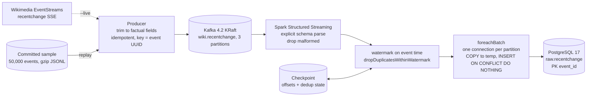

# Tributary

Streaming data platform with an evaluated analytics agent.

Tributary ingests an event stream through Kafka into a PostgreSQL warehouse
with Spark Structured Streaming, keeps an Apache Iceberg copy of the raw
events on object storage for Trino, models the warehouse with dbt under
Airflow with data-quality checks, serves it through FastAPI, and answers
questions about it in plain English with a text-to-SQL agent that is graded
on BIRD Mini-Dev (execution accuracy, PostgreSQL) and guarded against unsafe
queries. The demo data is the live Wikipedia edit stream; one
`docker compose up` brings the pipeline up with a committed sample.

**Status: the ingest spine works (milestone 1 of 8).** Kafka, the Spark job
and the PostgreSQL landing table run under Compose and are tested end to end
in CI. The warehouse models, lakehouse, agent and benchmarks are planned in
[PLAN.md](PLAN.md); measured numbers live in [RESULTS.md](RESULTS.md).

## Why

Teams that collect event data want a pipeline they can trust (no lost or
duplicated events) and a way to ask questions of the result. The pipeline
half has to be correct under retries, restarts and late data before any
question about it is worth answering, so that is where this starts.

## Quickstart

Requirements: Docker with Compose v2. For the host commands: Python 3.12 and
[uv](https://docs.astral.sh/uv/); Java 17 only to run Spark on the host.

```bash
docker compose up -d --build        # Kafka, PostgreSQL, the stream job, a one-shot sample replay
docker compose logs -f producer stream
docker compose exec postgres psql -U tributary -c \
  "SELECT wiki, count(*) FROM raw.recentchange GROUP BY 1 ORDER BY 2 DESC LIMIT 5"
```

The producer replays the 50,000-event sample at 500 events/s; on a 4-vCPU
machine the last row landed 113 s after `up`. From the host:

```bash
uv sync --all-extras
uv run tributary produce --limit 1000 --rate 0     # replay part of the sample, unthrottled
uv run tributary produce --live                    # the real Wikimedia stream (Ctrl-C to stop)
uv run tributary sample stats                      # what the sample looks like, incl. lateness
uv run tributary stream --available-now            # run the Spark job on the host until caught up
```

Demo: *screenshot placeholder.* To capture one, run the commands above and
record `docker compose logs -f stream` next to the `psql` query (for example
with `asciinema rec` and `agg`), saved as `docs/demo.gif`.

## Architecture



**The hard part: every event exactly once, under retries, restarts and late
data.** No single layer can promise that on its own, so each one covers a
different failure:

| Failure | What handles it |
|---|---|
| Producer retries after a lost ack | Kafka's idempotent producer (`enable.idempotence`, `acks=all`): the broker drops the retried copy. |
| The same event sent twice (re-run, live-stream reconnect) | `dropDuplicatesWithinWatermark` on the event UUID, keyed in Spark's state store. A copy arriving after its key expired is older than the watermark, and Spark drops it as late (pinned by a test). |
| A micro-batch replayed after a crash between the sink's write and Spark's commit | The sink: `COPY` into a temp table, then `INSERT ... ON CONFLICT (event_id) DO NOTHING`. Writing the same batch twice is a no-op. Spark's state cannot help here: the replay re-runs the batch from the previous state. |
| Offsets lost or truncated in Kafka | `failOnDataLoss=true`: the job stops instead of silently skipping. |
| Events that arrive late | The watermark delay (10 min) is chosen from the measured lateness of the real stream: p99 8 s, max 143 s over 50,000 events, 0 that a 10-minute delay would drop. Rows dropped by the watermark are logged per batch. |
| A poison message (bad JSON, bad UUID, a timestamp past year 9999, a NUL byte in a text field) | Counted as malformed and filtered before the sink, so one bad record cannot fail every replay of its batch. |

Kafka transactions cannot reach PostgreSQL, so end-to-end exactly-once here
means at-least-once delivery into an idempotent sink. The fault-injection
benchmark that kills the job and the broker mid-stream is milestone 5.

One consequence of event-time processing to know before replaying data by
hand: the watermark only moves forward. Once the job has seen events from
time *T*, anything older than *T* − 10 min is dropped as late, so replaying an
old file into a stack that has already ingested newer events loses it. Start
from `make down` (which deletes the checkpoint) to replay from scratch.

### Design decisions

| Decision | Chosen | Rejected | Why |
|---|---|---|---|
| Event time | MediaWiki `timestamp` (when the change happened) | `meta.dt` (when EventGate emitted it) | Questions are about when edits happened. `meta.dt` trails the change (p50 1.5 s, max 144 s in the sample); it is kept as `emitted_at`. |
| What enters Kafka | An allowlist of factual fields | The full event | Editor comments are free text under CC BY-SA; nothing downstream needs them, and an allowlist cannot leak a new field by accident. |
| Sink write | `COPY` into a temp table, then `INSERT ... ON CONFLICT DO NOTHING`, one connection per Spark partition | Spark JDBC writer | The JDBC writer cannot express `ON CONFLICT`, so a replayed batch would fail or duplicate. Per-partition connections give P parallel writers, which the scaling benchmark needs. |
| Dedup state store | RocksDB with changelog checkpointing | The default heap store | State spans twice the delay of event time (27,952 keys once the sample replay has settled, 30,827 at peak); RocksDB keeps it off the JVM heap and checkpoints only each batch's changes. The provider cannot change without a new checkpoint, so it is chosen up front. |
| Stream image | The official `apache/spark:4.1.3-python3` with the Kafka connector jars baked in (sha256-pinned) and a Python 3.12 venv | `--packages` at start-up | Nothing is downloaded when the job starts, so a restart works offline and the jars cannot change underneath it. |
| One image for producer and job | Shared | Separate slim producer image | One build in CI. The API milestone adds a slim app image. |

## Results

From [RESULTS.md](RESULTS.md), where each number has its command and raw
output. No model calls yet, so $0 spent.

| Measurement | Result |
|---|---|
| Sample lateness (50,000 live events, stream order) | 54% out of order; p99 8 s, max 143 s; 0 dropped at a 10-min watermark |
| `docker compose up` replay | 50,000 produced, 50,000 rows, 0 dropped, 0 malformed; last row 113 s after `up` |
| End-to-end test (CI) | 5,000 events land once; re-sending all of them changes no row and does not stall or restart the job |

## Development

See [CONTRIBUTING.md](CONTRIBUTING.md). `make check` is the gate (ruff,
mypy strict, offline unit tests including Spark in local mode);
`make test-integration` runs against Compose.

## Roadmap

M2 warehouse models, Iceberg lake and Airflow; M3 the guarded agent and API;
M4 BIRD harness; M5 fault-injection and scaling benchmarks; M6 Postgres vs
Trino over Iceberg; M7 agent quality; M8 release. Details in PLAN.md.

## Licence

MIT. The sample is derived from Wikimedia's public recentchange stream
(factual fields only, no comment text). Benchmark data (BIRD Mini-Dev,
CC BY-SA 4.0) is downloaded on demand and never committed.
